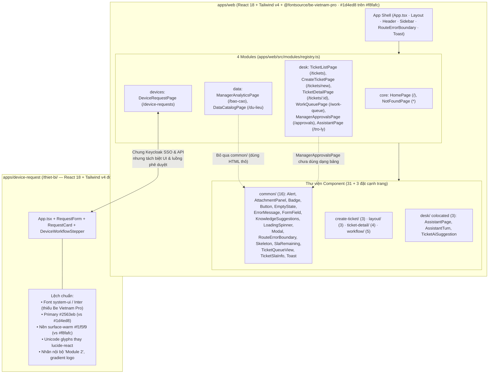

# Đánh giá toàn diện giao diện người dùng (UI/UX) DX-Desk — Hậu R2

Tài liệu này tổng hợp kết quả kiểm toán giao diện toàn diện (đáp ứng yêu cầu **R3**) trên nhánh `feature/enterprise-ui-lockdown` tại commit `9a8e7e3` (sau khi đã hoàn thành **R1** và **R2** gỡ bỏ chức năng chuyển đổi màu sắc và bố cục). Mọi phát hiện đều đối chiếu trực tiếp từ mã nguồn thực tế trong `apps/web/src/` và `apps/device-request/src/`.

> **Phạm vi:** Đánh giá hiện trạng toàn bộ màn hình, route, trạng thái shell, nhóm thành phần dùng chung và ứng dụng độc lập `/thiet-bi/`. Tài liệu này không đề xuất thay đổi mã nguồn ngoài phạm vi R2; bản đặc tả thiết kế đích được trình bày tại [Đề xuất thiết kế tối giản doanh nghiệp](de-xuat-thiet-ke-toi-gian-doanh-nghiep.md).

---

## 1. Tổng quan điều hành và phương pháp đánh giá

### 1.1 Đường cơ sở hậu R2 (`9a8e7e3`) và các cải tiến đã hạ cánh

So với giai đoạn đầu tuần phát triển, giao diện DX-Desk tại `9a8e7e3` đã được nâng cấp đáng kể qua ba cột mốc liên tiếp:

1. **PR #95 (`bb9378f`, `fix/accent-contrast`)**: Chuẩn hóa các token màu nền sáng trong `apps/web/src/index.css` đạt ngưỡng tương phản WCAG 2.1 AA/AAA: `--color-primary: #1d4ed8` (6,7:1 với chữ trắng), `--color-primary-hover: #1e40af`, `--color-primary-active: #1e3a8a`, `--color-content-muted: #475569` (7,6:1), `--color-content-subtle: #5e6e84` (5,2:1 trên `#ffffff`, 4,8:1 trên `#f1f5f9`), `--color-edge-control: #7f8ea3` (3,3:1 trên `#ffffff`, 3,0:1 trên `#f1f5f9`) và `--color-ring: #1d4ed8`.
2. **PR #77 (`5a8b939`, `feature/ticket-detail-ux`, 53 tệp)**:
   - Bổ sung `@fontsource/be-vietnam-pro` (`400/500/600/700`, OFL-1.1) tại `apps/web/src/main.tsx:10-13`, khai báo `--font-sans` trong `apps/web/src/index.css:86`, thêm thang chữ `.dx-page-title` (`24px/600`), `.dx-section-title` (`16px/600`), `.dx-meta` (`13px`) (`index.css:334-352`) và `font-variant-numeric: tabular-nums` trên `table, time, [data-numeric]` (`index.css:303-307`).
   - Ra mắt `SlaRemaining.tsx` (`apps/web/src/components/common/SlaRemaining.tsx`) và `apps/web/src/lib/sla.ts`, nâng cấp `TicketQueueView.tsx` cho `WorkQueuePage` sang dạng bảng `@3xl:grid` sắp xếp theo nguy cơ SLA và `PreviewPanel` neo phải (`#queue-preview`).
   - Tái cấu trúc `TicketDetailPage` và các thành phần con: loại bỏ trùng lặp `TicketSlaInfo` và UUID dài ở header, sửa `SlaPauseBanner` (bỏ `animate-pulse`, sửa nhảy cấp `<h4>` → `<h2>`, tách ngữ cảnh `audience: 'staff' | 'requester'`), di chuyển nút hủy/từ chối khỏi thanh dính dưới màn hình di động, bổ sung khung trả lời nội tuyến `replyEdge` và khôi phục focus khi bấm `Escape`, xây dựng lại `AttachmentPanel` với tải tệp một bước, đồng thời gỡ bỏ họa tiết dot-grid, blur orb và nút gradient khỏi `HomePage.tsx`.
3. **M1 — R2 (`9a8e7e3`, `refactor(ui): lock enterprise light corporate-blue theme and fixed layout`)**: Gỡ bỏ `ThemeContext.tsx`, `ThemeSwitcher.tsx`, `ThemeToggle.tsx`, xóa toàn bộ `.dark`, `[data-accent]`, `[data-theme]`, `[data-grid-lines]` và `darkMode: 'class'`, khóa cứng toàn hệ thống vào **Light Mode + Corporate Blue (`#1d4ed8`) + Fixed Left Sidebar & Sticky Top Header**.

### 1.2 Thống kê định lượng các vấn đề xuyên suốt tại `9a8e7e3`

Quét tự động toàn bộ `apps/web/src/` và `apps/device-request/src/` (không tính thư mục `test/`) cho thấy dù khung nền tảng đã vững, hệ thống vẫn tồn tại các mảng phân mảnh mang tính hệ thống:

| Nhóm chỉ số xuyên suốt | Số lượng tại `9a8e7e3` | Phân bố chính & Tác động |
|---|---|---|
| Chữ dưới `12px` (`text-[10px]`, `text-[11px]`) | **83 vị trí** | `CreateTicketPage` (18), `TicketListPage` (12), `HomePage` (10), `DeviceRequestPage` (7), `TicketKanbanBoard` (6), `AiTriageDiff` (6), `DynamicRequirementFields` (4), `KnowledgeSuggestions` (3), `CategorySelector` (2), `DeviceWorkflowStepper` (`web`: 1; `device-request`: 4), `apps/device-request/src/App.tsx` (4), v.v. Gây mỏi mắt trên màn hình laptop doanh nghiệp. |
| Bo góc tùy hứng / lệch chuẩn (`rounded-[2px..12px]`, `rounded-xl`, `rounded-2xl`) | **137+ vị trí** | Dùng xen kẽ literal `rounded-[2px]/[4px]/[6px]/[8px]/[10px]/[12px]` cùng `rounded-xl`/`rounded-2xl` (`AssistantPage`, `AssistantTurn`, `DataCatalogPage`, `NotFoundPage`) thay vì thang thống nhất của hệ thống thiết kế. |
| Alias di sản `surface-warm` | **40 vị trí** | `apps/device-request` (13), `TicketDetailPage` (9), `CreateTicketPage` (4), `TicketListPage` (4), `TicketQueueView` (3), `Button` (1), `EmptyState` (1), `Skeleton` (1), `TicketWorkflowActions` (1), `HomePage` (1), v.v. Tạo cảm giác nền ấm lai tạp với thang Slate lạnh. |
| Đổ bóng đại trà `.dx-main :is(section, form, article)` | **1 quy tắc CSS toàn cục** | `apps/web/src/index.css:257-259` ép `box-shadow` lên mọi thẻ `<section>`, `<form>`, `<article>` — kể cả form lồng bên trong card (`TicketWorkflowActions`, khung nhập `AssistantPage`) và vùng bao bố cục. |
| Hiệu ứng chuyển động vô hạn & phóng đại hover | **3 điểm động vô hạn + 1 keyframe dư** | `Header.tsx:129` (`animate-ping`), `HomePage.tsx:261` (`animate-ping`), `apps/device-request/src/RequestCard.tsx:20` (`animate-pulse`), cộng `.dx-pulse-glow` màu xanh lá cũ (`index.css:438-450`), `Sidebar.tsx:90,114` (`group-hover:scale-110`), `index.css:427` (`translateY(-2px)`). |
| Di sản màu ấm cũ & khoảng trống font | **4 nhóm lệch chuẩn** | `#e4e3e0` (`apps/web/src/index.css:417`, `apps/device-request/src/index.css:308`), `rgba(33,31,27,0.12)` (`TicketWorkflowActions.tsx:343`), thang `navy` dư (`tailwind.config.js:106-118`); chưa đóng gói `@fontsource/jetbrains-mono` dù khai báo `--font-mono`; `apps/device-request` hoàn toàn thiếu `Be Vietnam Pro`, dùng `#2563eb` và `#f1f5f9`. |

### 1.3 Tiêu chí đánh giá R3

Mỗi màn hình, module và nhóm thành phần dưới đây được chấm theo 4 trụ cột doanh nghiệp (căn cứ `PRODUCT.md` và chuẩn ITSM):

1. **Phân cấp thị giác (Visual Hierarchy):** Luồng quét mắt, tỷ lệ kích thước chữ, cấu trúc heading `h1 → h2 → h3`, tách biệt thông tin chính và metadata.
2. **Khả năng sử dụng (Usability):** Số bước thao tác, lọc/sắp xếp dữ liệu lớn, xử lý lỗi biểu mẫu, điều hướng bàn phím và màn hình nhỏ.
3. **Tính nhất quán (Consistency):** Mức độ dùng chung token CSS (`--color-*`), component gốc (`Button`, `Alert`, `FormField`, `Skeleton`, `Badge`), thuật ngữ tiếng Việt và sự đồng bộ giữa `apps/web` và `apps/device-request`.
4. **Tính phù hợp doanh nghiệp (Enterprise Suitability):** Độ tin cậy RBAC/Zero-Trust, sự điềm tĩnh chuyên nghiệp (không trang trí kiểu consumer/landing page), không rò rỉ chi tiết kỹ thuật nội bộ ra UI.

---

## 2. Sơ đồ kiến trúc bề mặt UI hiện tại

Sơ đồ dưới đây mô tả toàn bộ bề mặt giao diện của DX-Desk tại `9a8e7e3`, làm rõ cấu trúc shell, 4 module trong `apps/web`, 31+3 thành phần UI và độ lệch token/component so với `apps/device-request` (`/thiet-bi/`).

---

## 3. Đánh giá chi tiết từng màn hình, module và nhóm thành phần

### 3.1 App Shell (`Layout.tsx`, `Header.tsx`, `Sidebar.tsx`, Auth Gates, `RouteErrorBoundary.tsx`, `Toast.tsx`)

- **Phạm vi tệp:** `apps/web/src/components/layout/{Layout,Header,Sidebar}.tsx`, `apps/web/src/App.tsx`, `apps/web/src/components/common/{RouteErrorBoundary,Toast,LoadingSpinner}.tsx`, `apps/web/src/index.css`.
- **Điểm mạnh:**
  - Có liên kết nhảy nhanh `Bỏ qua điều hướng` (`Layout.tsx:18-23`), drawer di động bẫy focus kèm phím `Escape` và trả focus về nút mở (`Sidebar.tsx:24-69`), breadcrumb tự động theo `registry.ts:46-84`.
  - Các nút tác vụ ở `Header.tsx:114-196` đồng bộ chiều cao `h-9`; `RouteErrorBoundary.tsx` xử lý lỗi tải lazy chunk mạch lạc; `Toast.tsx:46-48` phân tách `role="alert"` / `role="status"` và tạm dừng bộ đếm khi rê chuột.
- **Vấn đề cụ thể:**
  1. `Header.tsx:53` + `index.css:249-253`: Header dùng nền bán trong suốt `bg-surface/95` + `color-mix(in srgb, var(--color-surface) 94%, transparent)` + `backdrop-filter: blur(12px)`, làm nội dung bảng dày bên dưới bị lộ mờ khi cuộn.
  2. `Header.tsx:129`: Chấm trạng thái API dùng `animate-ping` vô hạn; đồng thời gọi `getHealth()` lặp lại mỗi 30 giây (`Header.tsx:41`) độc lập với `HomePage.tsx`.
  3. `Header.tsx:118-169`: Nhãn trạng thái dịch vụ và danh sách `RoleBadge` ẩn bằng `hidden 2xl:flex` (`>= 1536px`). Trên laptop doanh nghiệp phổ biến (`1280px–1440px`), người dùng không nhìn thấy vai trò hiện tại của mình trên thanh đầu trang.
  4. `Header.tsx:77,157,175,187`: Trộn biến `--color-primary-ink` / `--color-primary-text`, dùng `<button>` thô với `text-xs` (`12px`) và `focus:ring-2` thay vì `<Button>` và `focus-visible:ring-2`.
  5. `Sidebar.tsx:90,114,138,174-191`: Khối giới thiệu tổ chức `TLU-OpenCoreSQN` ở chân sidebar chiếm diện tích dọc cố định mà không có tương tác; biểu tượng menu phóng đại `group-hover:scale-110`; mục đang chọn (`Sidebar.tsx:106`) chỉ tô nền `bg-state-selected` mà thiếu vạch chỉ báo cạnh trái (`border-l-2`), giảm độ rõ khi thu gọn `w-14`.
  6. `App.tsx:29-75`: Màn hình chưa đăng nhập (`:30`) dùng `<h2>` (`dx-section-title`, thiếu `<h1>` trên trang) và `<button>` thô (`:42`); thẻ Forbidden 403 (`:67-73`) lặp lại cấu trúc với `TicketQueueView.tsx:239-245`.
  7. `Toast.tsx:52-70,85`: Dùng `<h4>` độc lập trong portal (nhảy cấp heading) và `rounded-[6px]` + alias cũ `--color-success`/`--color-danger`.
  8. `index.css:257-259`: Quy tắc `.dx-main :is(section, form, article)` áp `box-shadow` lên mọi thẻ ngữ nghĩa, làm các form lồng hoặc section cấu trúc bị nổi khối không chủ đích.
- **Khoảng trống sẵn sàng doanh nghiệp:** Thanh header mờ xuyên thấu kết hợp đổ bóng blanket trên mọi `section/form/article` làm giảm sự sắc nét của giao diện dữ liệu; thiếu hiển thị vai trò ở độ phân giải `1280px–1440px`.
- **Mức ưu tiên:** **Cao (High)**.

---

### 3.2 Module `core` (`HomePage.tsx`, `NotFoundPage.tsx`)

- **Phạm vi tệp:** `apps/web/src/modules/core/pages/HomePage.tsx` (`/`), `apps/web/src/modules/core/pages/NotFoundPage.tsx` (`*`).
- **Điểm mạnh:**
  - PR #77 đã dọn bỏ nền dot-grid, blur orb trang trí và nút gradient ở `HomePage.tsx`; tích hợp chuẩn `useModuleEnabled` (`:29-30`), cảnh báo SSO ngoại tuyến (`:198-218`) và dữ liệu thật từ `getHealth()` (`:32-51`).
  - `NotFoundPage.tsx` cung cấp lối thoát rõ ràng về `/`.
- **Vấn đề cụ thể:**
  1. **Chỉ dẫn sai quyền RBAC (`PRODUCT.md:15,30`):** `HomePage.tsx:387-389` hiển thị cho *tất cả* người dùng đã đăng nhập: *"Sự cố ảnh hưởng nhiều người? Hãy tạo phiếu với mức ưu tiên Khẩn cấp để được xử lý trước."* — trong khi `CreateTicketPage.tsx:690-703,752` khóa mức `critical` (`Khẩn cấp`) chỉ dành cho `Manager`.
  2. **4 thẻ quảng bá tĩnh (`HomePage.tsx:298-335`):** Hiển thị 4 thẻ không bấm được (`Hạ tầng IT / Sẵn sàng 24/7`, `Phiếu sự cố / Đồng bộ tức thời`, `Cấp thiết bị / Đề xuất chuẩn hóa`, `Xác thực SSO / An toàn nội bộ`) với nhãn in hoa `text-[10px]` (`:304,313,322,331`) và không chứa số liệu vận hành hay liên kết điều hướng.
  3. **Trùng lặp widget sức khỏe dịch vụ & animation:** `HomePage.tsx:241-293` lặp lại thẻ trạng thái vốn đã có trên `Header.tsx` và dùng `animate-ping` (`:261`).
  4. **Không thích ứng vai trò:** Người dùng `Agent` hoặc `Manager` khi vào `/` vẫn chỉ thấy 3 thẻ thao tác của `Employee` (`:54-76`), thiếu lối tắt trực tiếp tới `/work-queue`, `/approvals` hay `/bao-cao`.
  5. **Di sản CSS & typography:** `HomePage.tsx:143` còn lớp `bg-clip-text` dư; `:152,179` dùng `backdrop-blur-xs`; `:225` dùng `surface-warm`; `:165,180,243,278,282,287` dùng `text-[11px]`; 17 chỗ dùng `rounded-[4px]/[6px]/[8px]`; `:356` dùng `hover:-translate-y-1 hover:shadow-[0_8px_20px_rgba(0,0,0,0.06)]`.
  6. `NotFoundPage.tsx:11,14,23`: Dùng `rounded-[12px]`, số `404` cỡ lớn `text-5xl font-black` và `<Link>` tạo dáng nút thô thay vì chuẩn `<Button>`.
- **Khoảng trống sẵn sàng doanh nghiệp:** Trang chủ đang mang dáng dấp trang giới thiệu sản phẩm (marketing/brochure) thay vì bàn điều phối theo vai trò, đồng thời vi phạm nguyên tắc *"giao diện trung thực với quyền"*.
- **Mức ưu tiên:** **Rất cao (Critical)** (do hứa hẹn sai quyền `critical` và thiếu điều hướng tác vụ cho Agent/Manager).

---

### 3.3 Module `desk`

#### 3.3.1 `TicketListPage.tsx` (`/tickets`)
- **Phạm vi tệp:** `apps/web/src/modules/desk/pages/TicketListPage.tsx`.
- **Điểm mạnh:** Đồng bộ URL query (`q`, `priority`, `status`, `page`, `view`), mỗi dòng là `<Link>` hỗ trợ Ctrl+click/middle-click (`:551`), có 3 biến thể `EmptyState` rõ ngữ cảnh (`:473-502`) và chuyển đổi `table | kanban`.
- **Vấn đề cụ thể:**
  1. **Lọc phía client trên từng trang 25 dòng (`:215-229,288-290`):** Ô tìm kiếm `q`, lọc `priority` và `status` chỉ lọc trong mảng `25` phiếu của trang `?page=N` hiện tại (vì `getTickets(PAGE_SIZE, currentOffset)` tại `services/api.ts:161-174` chưa truyền tham số lọc lên API). Khi hệ thống có >25 phiếu, người dùng tìm không thấy phiếu nằm ở trang khác.
  2. **Thiếu cột SLA và sắp xếp:** Khác với `WorkQueuePage`, `/tickets` không hiển thị thời gian SLA còn lại và không hỗ trợ sắp xếp theo hạn SLA.
  3. **Ngữ nghĩa bảng giả (`:524-542`):** Dùng `<ul className="divide-y">` kết hợp tiêu đề giả `aria-hidden="true"` (`dx-ticket-list-header` pha `var(--color-surface-warm)` ở `:529`) thay vì thẻ `<table>` ngữ nghĩa.
  4. **Chữ nhỏ & bo góc phân mảnh:** 12 vị trí chữ dưới `12px` (`text-[10px]` ở `:559,616`; `text-[11px]` ở `:283,356,391,413,450,529,573,592,605,613`) và 16 literal `rounded-[4px]/[6px]/[8px]`.
  5. **Trùng thanh lọc khi chuyển sang Kanban:** Khi chọn `view=kanban`, `TicketKanbanBoard` render thêm một thanh tìm kiếm + lọc mức ưu tiên ngay dưới thanh công cụ của `TicketListPage` (`:348-462` + `TicketKanbanBoard.tsx:373-413`).
- **Khoảng trống sẵn sàng doanh nghiệp:** Tìm kiếm/lọc 1 trang gây hụt dữ liệu khi quy mô phiếu tăng; thiếu hiển thị SLA; thanh công cụ kép ở chế độ Kanban.
- **Mức ưu tiên:** **Rất cao (Critical)**.

#### 3.3.2 `CreateTicketPage.tsx` (`/tickets/new`) + `create-ticket/` (3 thành phần)
- **Phạm vi tệp:** `apps/web/src/modules/desk/pages/CreateTicketPage.tsx`, `apps/web/src/components/create-ticket/{CategorySelector,DynamicRequirementFields,KnowledgeInlineHelper}.tsx`.
- **Điểm mạnh:** Tự lưu bản nháp theo user vào `localStorage` (`:69,124-158`), gợi ý bài Wiki tự phục vụ (`KnowledgeInlineHelper`), hướng dẫn ngữ cảnh `FIELD_GUIDES` (`DynamicRequirementFields.tsx:32-81`), khóa `critical` cho `Manager` (`:690-755`), `Modal` xác nhận hủy bài bản (`:1030-1086`).
- **Vấn đề cụ thể:**
  1. **Cảnh báo vàng xuất hiện trước khi người dùng tương tác (`:762-786`):** Khối `missingFieldLabels.length > 0` hiển thị banner vàng *"Chưa thể gửi phiếu - còn thiếu hoặc chưa hợp lệ"* ngay khi vừa mở trang, trước cả khi người dùng chạm vào ô nhập đầu tiên.
  2. **Điều hướng quay lại không nhất quán (`:406`):** Nút Quay lại trên đầu trang gọi `navigate(-1)`, mâu thuẫn trực tiếp với chú thích tại `:168` (*"không dùng navigate(-1) vì trang có thể được mở trực tiếp"*).
  3. **Phản hồi đính kèm sau gửi chưa được định dạng (`:482-496`):** Thông báo *"Phiếu đã được tạo. Đang quét và tải tệp…"* và nút thử lại (`:494`) là `
` và `<button>` thô không qua `<Alert>` / `<Button>`.
  4. **Trạng thái nút gửi gây hiểu nhầm (`:902`):** Khi `!canSubmit`, nút gửi dùng `aria-disabled={!canSubmit}` kèm `opacity-50 cursor-not-allowed` nhưng vẫn cho phép bấm để chạy `onSubmit`, khiến người dùng tưởng nút bị vô hiệu hóa hoàn toàn.
  5. **Mật độ chữ <12px và token cũ:** Tổng cộng 24 vị trí `<12px` (`CreateTicketPage`: 18, `CategorySelector`: 2, `DynamicRequirementFields`: 4), 17 `rounded-[4px]/[6px]/[8px]`, 4 `surface-warm` (`:707,880,887,927`), nhãn thừa `Biểu mẫu tiếp nhận IT` (`:412-415`) và thanh dính dưới dùng `backdrop-blur` (`:880`).
- **Khoảng trống sẵn sàng doanh nghiệp:** Cảnh báo lỗi sớm tạo cảm giác áp lực không cần thiết; nút gửi giả vô hiệu hóa làm gián đoạn luồng Employee trên di động.
- **Mức ưu tiên:** **Cao (High)**.

#### 3.3.3 `TicketDetailPage.tsx` (`/tickets/:id`) + `ticket-detail/` (4) + `TicketAiSuggestion.tsx` + `AiTriageDiff.tsx`
- **Phạm vi tệp:** `apps/web/src/modules/desk/pages/TicketDetailPage.tsx`, `apps/web/src/components/ticket-detail/{TicketAttachmentSection,TicketDetailHeader,TicketTimeline,TicketWorkflowActions}.tsx`, `apps/web/src/modules/desk/TicketAiSuggestion.tsx`, `apps/web/src/components/workflow/AiTriageDiff.tsx`.
- **Điểm mạnh:** Đây là màn hình được cải thiện mạnh nhất trong PR #77: `TicketDetailNav` nằm toàn chiều rộng phía trên lưới 2 cột (`:152-156`), `SlaPauseBanner` tách văn phong `staff` vs `requester`, khung `replyEdge` dẫn lại câu hỏi của kỹ thuật viên, nút hủy/từ chối tách khỏi thanh dính di động, hỗ trợ `Escape` + trả focus, và hộp tải tệp một bước trong `AttachmentPanel`.
- **Vấn đề cụ thể:**
  1. **Trùng lặp trạng thái & callout rẽ nhánh:** `StatusBadge` vẫn hiển thị 2 lần trên desktop (`TicketDetailHeader.tsx:70` và `TicketWorkflowActions.tsx:354`); `TicketStageTracker.tsx:296-337` lặp lại thông báo `role="status"` cho `pending_approval` và `cancelled` bên trên `SlaPauseBanner`.
  2. **Timeline chưa có đảo chiều mới nhất trước (`TicketTimeline.tsx:87-96`):** Lịch sử vẫn xếp cũ nhất trước, khiến phản hồi mới nhất bị đẩy xuống cuối trên các phiếu trao đổi dài.
  3. **Nhảy cấp heading (`h1 → h3`) ở AI Triage:** `AiTriageDiff.tsx:108` xuất `<h3>` trực tiếp dưới `<h1>` của `TicketDetailHeader.tsx:82` mà không có `<h2>` trung gian.
  4. **Lộ UUID thô & khoảng trống di động quá lớn:** `TicketDetailHeader.tsx:123` hiển thị `Chưa có tên nhóm (${ticket.assigned_team_id})`; `TicketDetailPage.tsx:148-150` đặt `max-lg:pb-[75vh]` khi `bottomBar === 'tall'` tạo khoảng trắng khổng lồ ở chân trang di động; `TicketDetailPage.tsx:87-115` tự viết skeleton 35 dòng dùng `surface-warm` thay vì `<Skeleton>`.
  5. **Di sản style & nội dung AI (`AiTriageDiff.tsx`, `TicketAiSuggestion.tsx`, `TicketWorkflowActions.tsx`):** `TicketWorkflowActions.tsx:343,402` còn bóng Notion `rgba(33,31,27,0.12)` và `bg-surface-warm`; `AiTriageDiff.tsx` có 6 chữ `<12px` (`:112,128,141,149,158,174`), tiêu đề toàn chữ hoa dài, nhãn song ngữ `(Low)/(Normal)/(High)/(Critical)` (`:36-41`), dùng 3 lý do tĩnh gán cứng (`'Khớp nội dung mô tả'`, `'Phát hiện sự cố trọng yếu'`, `'Định tuyến tự động'`, `:74,84,92`) khiến người dùng nhầm là lập luận của AI; `TicketAiSuggestion.tsx:11,141-142` dùng chuỗi CSS thủ công và `
` thô.
- **Khoảng trống sẵn sàng doanh nghiệp:** Vẫn xếp chồng 3 khối đầu trang trước mô tả phiếu trên màn hình laptop/di động; timeline thiếu tùy chọn mới nhất trước; AI triage cần trung thực về nguồn gợi ý.
- **Mức ưu tiên:** **Trung bình (Medium)**.

#### 3.3.4 `WorkQueuePage.tsx` (`/work-queue`) & `TicketQueueView.tsx` (`approvals=false`)
- **Phạm vi tệp:** `apps/web/src/modules/desk/pages/WorkQueuePage.tsx`, `apps/web/src/components/common/TicketQueueView.tsx`.
- **Điểm mạnh:** Là màn hình vận hành chuẩn doanh nghiệp nhất hậu PR #77: danh sách bảng `@3xl:grid` (`QueueRow`), hiển thị `SlaRemaining`, mặc định xếp việc gấp trước (`breached` → `at_risk` → `running`), bộ đếm tab theo hàng đợi và `PreviewPanel` neo phải hỗ trợ `Escape` + trả focus.
- **Vấn đề cụ thể:**
  1. **Lọc và xếp SLA chỉ chạy trên 25 phiếu của 1 trang (`TicketQueueView.tsx:174-187`):** Tương tự `TicketListPage`, vì API chưa có tham số lọc/sắp xếp server, một phiếu quá hạn SLA ở trang 2 sẽ không nổi lên đầu trang 1.
  2. **Phân trang thiếu số trang tại chỗ (`:250-255`):** Thanh điều hướng dưới chỉ có 2 nút `Trang trước` / `Trang sau` (tổng số trang đặt tách biệt phía trên bảng tại `:402`).
  3. **`PreviewPanel` lộ key thô & `surface-warm` (`:428,539`):** Hiển thị nguyên key snake_case `<dt>{key}</dt>` của `request_fields` (`:539`) thay vì nhãn tiếng Việt; đầu bảng dùng `bg-surface-warm` (`:428`).
  4. **Lặp thanh lọc ở Kanban & bỏ qua `Button`/`FormField` (`:19-23,373-423`):** Chế độ Kanban lặp lại bộ lọc của `TicketKanbanBoard`; tệp tự khai báo hằng `BUTTON`, `PRIMARY`, `FIELD` thay vì dùng `Button` và `fieldClass`.
- **Khoảng trống sẵn sàng doanh nghiệp:** Rủi ro bỏ sót phiếu vỡ SLA nằm ở trang sau đi ngược nguyên tắc *"Việc gấp nổi lên trước"* (`PRODUCT.md:66`).
- **Mức ưu tiên:** **Rất cao (Critical)**.

#### 3.3.5 `ManagerApprovalsPage.tsx` (`/approvals`) & `TicketQueueView.tsx` (`approvals=true`)
- **Phạm vi tệp:** `apps/web/src/modules/desk/pages/ManagerApprovalsPage.tsx`, `apps/web/src/components/common/TicketQueueView.tsx`.
- **Điểm mạnh:** Hiển thị đủ ngữ cảnh phê duyệt, form inline nhập lý do từ chối tối thiểu 5 ký tự (`:298-305`), quản lý focus (`decisionRef` / `decisionTrigger`) và xử lý xung đột 409 (`:201-204`).
- **Vấn đề cụ thể:**
  1. **Chưa đồng bộ giao diện bảng như `WorkQueuePage` (`:262-314`):** Vẫn dùng lưới thẻ 2 cột kiểu cũ, thiếu bảng quét nhanh, thiếu `PreviewPanel`, thiếu `SlaRemaining`, thiếu lọc/tìm kiếm và thiếu sắp xếp SLA.
  2. **Lộ key thô `request_fields` (`:287-289`):** Hiển thị tên trường kỹ thuật (`system_name`, `valid_until`, ...) trực tiếp cho Quản lý.
  3. **Xô lệch lưới khi mở form & token cũ:** Mở form từ chối làm giãn chiều cao một thẻ trong lưới 2 cột; dùng `bg-surface-warm` (`:287,298`) và `text-danger` thô (`:295`) thay vì `Button variant="dangerOutline"`.
- **Khoảng trống sẵn sàng doanh nghiệp:** Tốc độ rà soát danh sách phê duyệt chậm khi số lượng yêu cầu lớn; rò rỉ tên trường kỹ thuật.
- **Mức ưu tiên:** **Cao (High)**.

#### 3.3.6 `TicketKanbanBoard.tsx`
- **Phạm vi tệp:** `apps/web/src/components/workflow/TicketKanbanBoard.tsx`.
- **Điểm mạnh:** Phân chia swimlane ưu tiên `Khẩn cấp` tách khỏi luồng chuẩn, hỗ trợ nhận phiếu nhanh theo cột trạng thái.
- **Vấn đề cụ thể:**
  1. **Trộn tiếng Anh & in hoa dày đặc (`:152-290`):** Hiển thị `KANBAN VẬN HÀNH IT`, `CRITICAL SWIMLANE`, `STANDARD SWIMLANE`, `{ticket.priority.toUpperCase()}`, `Khẩn cấp (Critical)` — trái quy chuẩn thuần Việt (`PRODUCT.md:45-46`).
  2. **6 vị trí chữ <12px (`:224,259,264,282,290,312`):** Tiêu đề cột, số lượng và metadata quá nhỏ.
  3. **Ngữ nghĩa tương tác & heading:** Dùng `<article tabIndex={0}>` click được thay vì `<Link>`/`<button>` lồng trong thẻ; thẻ dùng `<h4>` (`:277`) khi chưa có `<h2>`/`<h3>`.
  4. **Thanh lọc dư thừa (`:373-413`):** Nhân đôi thanh tìm kiếm và lọc ưu tiên bên dưới thanh công cụ của `TicketListPage` / `WorkQueuePage`.
- **Khoảng trống sẵn sàng doanh nghiệp:** Thiếu nhất quán ngôn ngữ và ngữ nghĩa bàn phím; thanh công cụ trùng lặp gây rối mắt.
- **Mức ưu tiên:** **Cao (High)**.

#### 3.3.7 `AssistantPage.tsx` (`/tro-ly`) & `AssistantTurn.tsx`
- **Phạm vi tệp:** `apps/web/src/modules/desk/AssistantPage.tsx`, `apps/web/src/modules/desk/AssistantTurn.tsx`.
- **Điểm mạnh:** Bố cục 2 phần tách biệt kèm drawer di động, stream SSE Markdown an toàn (`remark-gfm`, chặn `img`), khối công cụ thu gọn (`
`), lọc URL nguồn Wiki an toàn, thẻ xác nhận con người duyệt (`Xác nhận` / `Hủy đề xuất`) và nút dừng `AbortController`.
- **Vấn đề cụ thể:**
  1. **Lệch bo góc & nền che consumer:** Dùng `rounded-2xl` (`AssistantPage.tsx:422,611`; `AssistantTurn.tsx:40`) và `rounded-xl` (`AssistantPage.tsx:439,464,647,656,664`; `AssistantTurn.tsx:129`) lệch chuẩn `6px/8px`; nền che dùng `bg-black/20` (`AssistantPage.tsx:428`) khác `bg-slate-950/60` ở `Modal`/`Sidebar`.
  2. **Bỏ qua component chuẩn:** Các nút đổi tên, xóa trong `Modal` (`:683-696`), đề xuất hành động (`AssistantTurn.tsx:141-156`) và banner lỗi (`AssistantPage.tsx:553`, `AssistantTurn.tsx:183` thiếu `bg-status-danger-bg`) tự viết CSS thay vì dùng `Button` và `Alert`/`ErrorMessage`.
  3. **Heading & focus:** Mỗi lượt hỏi chèn `<h2 className="sr-only">` (`AssistantTurn.tsx:41`) và ép toàn bộ heading Markdown `h1/h2/h3` thành `<h3>` (`:72-74`); form đổi tên dùng `autoFocus` (`AssistantPage.tsx:469`) nhưng không trả focus khi bấm `Escape`/hủy.
  4. **Lộ ID thô (`AssistantTurn.tsx:170`):** In `Đã tạo công việc ${result.id}` (UUID nội bộ).
- **Khoảng trống sẵn sàng doanh nghiệp:** Diện mạo giống chatbot tiêu dùng (`rounded-2xl`), cảnh báo lỗi thiếu độ tương phản nền.
- **Mức ưu tiên:** **Trung bình (Medium)**.

---

### 3.4 Module `devices` (`DeviceRequestPage.tsx` & `DeviceWorkflowStepper.tsx`)

- **Phạm vi tệp:** `apps/web/src/modules/devices/pages/DeviceRequestPage.tsx` (`/device-requests`), `apps/web/src/components/workflow/DeviceWorkflowStepper.tsx`.
- **Điểm mạnh:** Chọn thiết bị trực quan dạng icon-card, nút tăng/giảm số lượng đạt 44px (`min-h/w-11`, `:416-451`), sticky CTA trên di động, có đường rẽ từ chối và tải PDF biên bản bàn giao.
- **Vấn đề cụ thể:**
  1. **Rò rỉ đường dẫn API nội bộ (`DeviceRequestPage.tsx:349-351`):** Đầu biểu mẫu gắn nhãn pill `POST /api/device-requests` hiển thị trực tiếp cho nhân viên cuối.
  2. **Rò rỉ tên hệ thống lưu trữ (`DeviceWorkflowStepper.tsx:233`):** Ghi *"Biên bản bàn giao lưu trữ an toàn trên hệ thống SeaweedFS."* thay vì ngôn ngữ nghiệp vụ.
  3. **Thiếu bộ lọc, tìm kiếm và tách hàng đợi:** Khác với `/thiet-bi/`, `/device-requests` chỉ hiển thị một danh sách phẳng tối đa 25 thẻ/trang.
  4. **Chữ <12px, heading skip & skeleton tùy chế:** 7 vị trí `text-[11px]` (`:349,453,475,501,553,617,628`), 1 `text-[10px]` (`DeviceWorkflowStepper.tsx:169`), nhảy cấp `<h4>` (`DeviceWorkflowStepper.tsx:190,226`), in đầy đủ UUID `ID: {req.id}` (`:618`), 21 lớp `rounded-[2px..8px]`, và tự viết `RequestListSkeleton` (`:111-135`) thay vì dùng `<Skeleton>`.
- **Khoảng trống sẵn sàng doanh nghiệp:** Lộ chi tiết hạ tầng (`POST /api/device-requests`, `SeaweedFS`) và phân mảnh trải nghiệm với `/thiet-bi/`.
- **Mức ưu tiên:** **Cao (High)**.

---

### 3.5 Module `data` (`ManagerAnalyticsPage.tsx`, `DataCatalogPage.tsx`)

- **Phạm vi tệp:** `apps/web/src/modules/data/pages/ManagerAnalyticsPage.tsx` (`/bao-cao`), `apps/web/src/modules/data/pages/DataCatalogPage.tsx` (`/du-lieu`).
- **Điểm mạnh:** `ManagerAnalyticsPage` nhúng iframe Metabase ký JWT với `referrerPolicy="no-referrer"` và `sandbox`; `DataCatalogPage` khai thác đủ DCAT/JSON-LD, có chỉ báo dữ liệu mẫu và sao chép URI.
- **Vấn đề cụ thể:**
  1. **Bỏ qua hoàn toàn thư viện component `common/`:**
     - `ManagerAnalyticsPage.tsx:30-38`: Dùng `<button>`, `
` và `
Đang tải báo cáo…
` thô thay vì `<Button>`, `<ErrorMessage>` và `<LoadingSpinner>` / `<Skeleton>`.
     - `DataCatalogPage.tsx:93-160`: Dùng `rounded-xl` (`:93,106,120`), `
` không khung nền (`:103,129,130,151,159`), `<button>` thô (`:134,147`) và khối `<pre>` thiếu nút sao chép nhanh hoặc viền phân cách (`:158`).
  2. **Thiếu trạng thái tải iframe & làm sạch URL giấy phép:** `ManagerAnalyticsPage` để trống khung `min-h-[75vh]` trong lúc Metabase dựng biểu đồ; `DataCatalogPage:111` in nguyên URL `dataset.license` nếu không phải CC0.
- **Khoảng trống sẵn sàng doanh nghiệp:** Hai trang dữ liệu trông như nguyên mẫu HTML thô, lạc lõng hoàn toàn so với `desk` và `devices`.
- **Mức ưu tiên:** **Cao (High)**.

---

### 3.6 Kiểm kê nhóm Component dùng chung (`apps/web/src/components/`)

1. **`common/` (16 thành phần):**
   - `Button.tsx`: API 7 biến thể × 3 kích cỡ, đạt chuẩn 44px trên di động và `aria-busy`, nhưng `:18` còn lớp chết `hover:from-[...] hover:to-[...]` và `:30` dùng `surface-warm`. Nhiều trang (`HomePage`, `TicketListPage`, `CreateTicketPage`, `DeviceRequestPage`, `TicketQueueView`, `AssistantPage`, `DataCatalogPage`, `ManagerAnalyticsPage`) vẫn viết `<button>` thủ công.
   - `Badge.tsx`: Tách `StatusBadge`, `PriorityBadge`, `RoleBadge`, nhưng `RoleBadge` (`:164,171,178`) viết song ngữ `Quản lý (Manager)` / `Kỹ thuật viên (Agent)` / `Nhân viên (Employee)` (lệch với `PRODUCT.md:45` và `apps/device-request`), đồng thời dùng chung kiểu nhãn pill cho cả vai trò, trạng thái và bộ đếm.
   - `Alert.tsx:48` & `Toast.tsx:85`: Cố định thẻ `<h4>` bất kể độ sâu heading của trang chứa.
   - `Modal.tsx`: Bẫy focus, `Escape`, trả focus tốt (`:43-211`) nhưng mới dùng ở `CreateTicketPage` và `AssistantPage`.
   - `Skeleton.tsx`: Có sẵn `Skeleton`, `SkeletonText`, `SkeletonCard`, `SkeletonTable`, `SkeletonPage` (`:127` còn `surface-warm`), nhưng `TicketDetailPage` và `DeviceRequestPage` vẫn tự viết skeleton riêng.
   - `FormField.tsx`: Chuẩn `fieldClass`/`FieldError` nhưng bị bỏ qua tại `TicketListPage`, `DeviceRequestPage`, `TicketQueueView`, `TicketWorkflowActions`, `TicketAiSuggestion`.
   - `KnowledgeSuggestions.tsx`: Chứa `text-[11px]` (`:77,148,154`), `rounded-[4px]/[6px]` và `<h4>` (`:95`) dưới `<h3>` (`:73`).
   - `TicketSlaInfo.tsx:15,18`: Dùng thuật ngữ nội bộ `Hạn gốc SLA` và alias cũ `text-danger`.
   - `EmptyState.tsx:24`: Dùng `surface-warm`.
   - `ErrorMessage.tsx`, `LoadingSpinner.tsx`, `RouteErrorBoundary.tsx`, `SlaRemaining.tsx`, `AttachmentPanel.tsx`: Cấu trúc tốt, cần mở rộng sử dụng ở các trang đang viết thẻ thô.
2. **`create-ticket/` (3):** `CategorySelector` (`text-[11px]` ×2), `DynamicRequirementFields` (`text-[11px]` ×4), `KnowledgeInlineHelper` (gắn với `KnowledgeSuggestions`).
3. **`layout/` (3):** `Header.tsx`, `Layout.tsx`, `Sidebar.tsx` (đã đánh giá tại mục 3.1).
4. **`ticket-detail/` (4):** `TicketAttachmentSection`, `TicketDetailHeader`, `TicketTimeline`, `TicketWorkflowActions` (đã đánh giá tại mục 3.3.3).
5. **`workflow/` (5):** `AiTriageDiff`, `DeviceWorkflowStepper`, `SlaPauseBanner`, `TicketKanbanBoard`, `TicketStageTracker` (nổi bật nhất là `TicketKanbanBoard`, `AiTriageDiff` và `DeviceWorkflowStepper`).

---

### 3.7 Ứng dụng độc lập `apps/device-request` (`/thiet-bi/`)

- **Phạm vi tệp:** `apps/device-request/src/{App,RequestForm,RequestCard,DeviceWorkflowStepper}.tsx`, `apps/device-request/src/index.css`.
- **Điểm mạnh:** Phân tách chuẩn 3 hàng đợi cho Quản lý/IT (`waiting`, `mine`, `followed`), kiểm quyền `actionsFor` khớp migration 018 của PostgreSQL, bắt buộc nhập lý do khi từ chối, mở xem lịch sử sự kiện gọn gàng.
- **Vấn đề cụ thể & độ lệch so với `apps/web`:**
  1. **Lệch màu chủ đạo & nền (`apps/device-request/src/index.css:110,332`, `App.tsx:39`):** Đặt `--color-primary: var(--blue-600)` (`#2563eb`) thay vì `#1d4ed8` của `apps/web`; `body` và wrapper dùng `surface-warm` (`#f1f5f9`) thay vì `#f8fafc` (`--color-background`); thiếu `--color-edge-control` (3,3:1), `--color-primary-ink`, `--color-state-*` và `--color-status-*-solid`.
  2. **Lệch font chữ & hệ biểu tượng (`index.css:83,331`, `App.tsx:43,58,88`):** Không import `@fontsource/be-vietnam-pro` (khai báo `"Inter"` nhưng bị `body` ghi đè thành `system-ui`); không cài `lucide-react` mà dùng ký tự Unicode (`✕`, `✓`, `←`) và logo `bg-gradient-to-br` (`App.tsx:43`).
  3. **CSS di sản & hiệu ứng dư (`index.css:308`, `App.tsx:40`, `RequestCard.tsx:20,90`):** Còn `#e4e3e0`, `backdrop-blur-md`, chấm `animate-pulse` vô hạn trên trạng thái `preparing` (`RequestCard.tsx:20`) và `dx-card-hover` nâng thẻ `-2px` (`RequestCard.tsx:90`).
  4. **Chữ <12px, bo góc lệch chuẩn, vùng chạm & nhãn dev:** 8 vị trí `<12px` (`App.tsx:49,58,67,80`; `DeviceWorkflowStepper.tsx:27,34,38,56`); pill trạng thái dùng `rounded-full` (`RequestCard.tsx:98`) khác `rounded-sm` của `Badge.tsx`; header lộ nhãn kỹ thuật `Module 2` (`App.tsx:49`); nút thao tác trong `RequestCard.tsx:118-139` thiếu `min-h-[44px]` trên di động; `RequestForm.tsx:65` viết nút thô.
  5. **Phân mảnh nghiệp vụ với `/device-requests`:** `/thiet-bi/` hỗ trợ Quản lý/IT duyệt, chuẩn bị và bàn giao, trong khi `/device-requests` ở `apps/web` chỉ phục vụ người gửi yêu cầu với stepper và giao diện hoàn toàn khác.
- **Khoảng trống sẵn sàng doanh nghiệp:** Hai ứng dụng dùng chung Keycloak SSO nhưng hiển thị như hai phần mềm khác hãng (`#2563eb` vs `#1d4ed8`, `system-ui` vs `Be Vietnam Pro`, `Module 2`, thiếu chuẩn chạm di động 44px).
- **Mức ưu tiên:** **Rất cao (Critical)**.

---

## 4. Ma trận tổng hợp phát hiện theo mức độ ưu tiên

| Mức độ | Phát hiện cốt lõi | Màn hình / Khu vực bị ảnh hưởng | Trụ cột bị tác động |
|---|---|---|---|
| **Rất cao (Critical)** | Hứa hẹn sai quyền đặt mức `Khẩn cấp` cho mọi người dùng; thiếu điều hướng cho Agent/Manager | `HomePage` | Tính phù hợp DN, Khả năng sử dụng |
| **Rất cao (Critical)** | Lọc, tìm kiếm và xếp SLA chỉ chạy trên lát cắt 25 phiếu của 1 trang | `TicketListPage`, `WorkQueuePage` (`TicketQueueView`) | Khả năng sử dụng, Tính phù hợp DN |
| **Rất cao (Critical)** | Lệch màu `#2563eb`, nền `#f1f5f9`, font `system-ui`, thiếu `Be Vietnam Pro`/`lucide-react`, lộ nhãn `Module 2` | `apps/device-request` (`/thiet-bi/`) | Tính nhất quán, Tính phù hợp DN |
| **Cao (High)** | Đổ bóng đại trà `.dx-main :is(section, form, article)`, header mờ xuyên thấu, `RoleBadge` ẩn dưới `2xl`, `animate-ping`/`scale-110` | App Shell (`Header`, `Sidebar`, `index.css`) | Phân cấp thị giác, Tính nhất quán |
| **Cao (High)** | 83 vị trí chữ `<12px`, 137+ bo góc tùy hứng, 40 `surface-warm`, `#e4e3e0` | Toàn hệ thống (`apps/web` + `apps/device-request`) | Phân cấp thị giác, Tính nhất quán |
| **Cao (High)** | Bỏ qua hoàn toàn `Button`, `Alert`, `ErrorMessage`, `Skeleton` (viết HTML thô) | `ManagerAnalyticsPage`, `DataCatalogPage` | Tính nhất quán, Khả năng sử dụng |
| **Cao (High)** | Chưa có dạng bảng/`PreviewPanel`/SLA ở màn hình Phê duyệt; lộ key snake_case `request_fields` | `ManagerApprovalsPage`, `TicketQueueView` | Khả năng sử dụng, Tính phù hợp DN |
| **Cao (High)** | Cảnh báo vàng hiển thị trước khi nhập, `navigate(-1)`, nút gửi `opacity-50` gây hiểu nhầm | `CreateTicketPage` | Khả năng sử dụng |
| **Cao (High)** | Trộn tiếng Anh/Việt (`CRITICAL SWIMLANE`), lặp thanh lọc Kanban, click `<article>` | `TicketKanbanBoard` | Tính nhất quán, Khả năng sử dụng |
| **Cao (High)** | Lộ endpoint `POST /api/device-requests` và hạ tầng `SeaweedFS`, `ID` UUID | `DeviceRequestPage`, `DeviceWorkflowStepper` | Tính phù hợp DN |
| **Trung bình (Medium)** | Trùng `StatusBadge`, timeline cũ trước, nhảy cấp heading ở `AiTriageDiff`, `max-lg:pb-[75vh]`, lý do AI gán cứng | `TicketDetailPage`, `TicketTimeline`, `AiTriageDiff` | Phân cấp thị giác, Khả năng sử dụng |
| **Trung bình (Medium)** | Bo góc consumer `rounded-2xl`/`xl`, bỏ qua `Button`/`Alert`, lộ UUID `result.id` | `AssistantPage`, `AssistantTurn` | Tính nhất quán, Tính phù hợp DN |
| **Trung bình (Medium)** | 4 thẻ promo tĩnh ở Trang chủ, trùng widget sức khỏe dịch vụ, `NotFoundPage` `font-black` | `HomePage`, `NotFoundPage` | Phân cấp thị giác, Tính phù hợp DN |
| **Thấp (Low)** | Đóng gói thiếu `@fontsource/jetbrains-mono`; thang `navy` dư trong `tailwind.config.js`; `RoleBadge` song ngữ | `index.css`, `tailwind.config.js`, `Badge.tsx` | Tính nhất quán |
