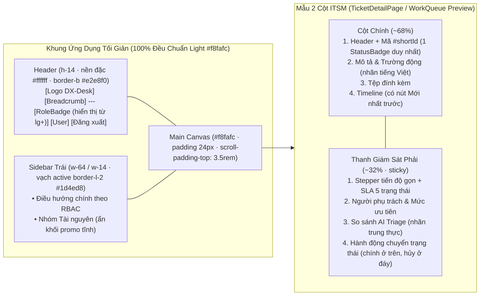

# Đề xuất và đặc tả thiết kế tối giản chuyên nghiệp cho doanh nghiệp (DX-Desk)

> **Tuyên bố phạm vi (R4 — Chỉ đặc tả, KHÔNG triển khai mã nguồn):** Tài liệu này là **bản đề xuất và đặc tả thiết kế bằng văn bản** đáp ứng yêu cầu **R4**. Ngoại trừ việc đã gỡ bỏ chức năng chuyển đổi màu sắc và bố cục ở giai đoạn **R2** (commit `9a8e7e3` trên nhánh `feature/enterprise-ui-lockdown`), các thay đổi thiết kế chi tiết trong tài liệu này **chưa được triển khai vào mã nguồn** và sẽ được thực hiện theo lộ trình ở Mục 4.

---

## 1. Luận chứng giữ lại bảng màu và bố cục doanh nghiệp (Quyết định R2)

Ở bước **R2**, toàn bộ giao diện chọn giao diện sáng/tối (`ThemeContext.tsx`, `ThemeSwitcher.tsx`, `ThemeToggle.tsx`), 11+1 bộ màu nhấn tùy chọn (`ACCENT_PRESETS`, `custom`) và 3 kiểu bố cục (`THEME_PRESETS`: `clear`/`modern`/`classic`, `tableGridLines`) đã được gỡ bỏ để khóa hệ thống vào một chuẩn duy nhất: **Chế độ Sáng cố định (Fixed Light Mode) + Xanh Doanh nghiệp (`corporate-blue`, `#1d4ed8` trên nền Slate `#f8fafc`/`#ffffff`) + Thanh điều hướng bên trái cố định (`w-64`/`w-14` & drawer di động) + Thanh đầu trang dính (`h-14`)**.

### 1.1 Vì sao giữ Chế độ Sáng cố định + `corporate-blue` (`#1d4ed8`) trên nền Slate?

| Tiêu chí so sánh | Lựa chọn giữ lại: **Fixed Light + `corporate-blue` (`#1d4ed8`)** | Phương án loại bỏ: **Dark / Dual-Mode & Classic Sepia / Đa màu nhấn** |
|---|---|---|
| **Tương phản WCAG 2.1 AA/AAA** | Đã kiểm chứng trực tiếp trong `apps/web/src/index.css:93-169`: chữ chính `#0f172a` trên `#ffffff` đạt **17,9:1**; chữ phụ `#475569` đạt **7,6:1**; metadata `#5e6e84` đạt **5,2:1** (`4,8:1` trên `#f1f5f9`); viền điều khiển `--color-edge-control` (`#7f8ea3`) đạt **3,3:1** (`3,0:1` trên `#f1f5f9`); màu chủ đạo `#1d4ed8` đạt **6,7:1** cả chữ trắng trên nền xanh lẫn chữ xanh trên nền trắng. | Chế độ tối cũ gây tụt tương phản (chữ lỗi `2,9:1`, thiếu token trạng thái tối), còn gói `classic` sepia (`#f7f6f3`, `#cb912f`, `#8a8884`) trượt chuẩn AA (`PriorityBadge` High chỉ đạt `2,8:1`, chữ phụ `#8a8884` đạt `3,5:1`). |
| **Tỷ lệ 60/30/10 & Kỷ luật đơn sắc** | Tuân thủ quy tắc thương hiệu 60–70% nền trung tính Slate (`#f8fafc` / `#ffffff`), 20–30% bề mặt phụ & viền (`#f1f5f9` / `#e2e8f0`), và 5–10% màu nhấn đơn (`#1d4ed8`) cho CTA chính, focus ring và mục đang chọn. | Cho phép người dùng tự đổi màu nhấn sang hồng, vàng, đỏ, cam làm **va chạm ngữ nghĩa** trực tiếp với màu trạng thái ITSM (đỏ = quá hạn SLA/khẩn cấp, hổ phách = chờ phản hồi, xanh lá = hoàn tất, tím = chờ phê duyệt). |
| **Đồng bộ hệ sinh thái nhúng & in ấn** | Khớp hoàn toàn với iframe báo cáo **Metabase** (`ManagerAnalyticsPage`), tài liệu biên bản bàn giao **PDF** (SeaweedFS) và môi trường văn phòng sáng của nhân sự nội bộ. | Giảm gấp đôi chi phí kiểm thử WCAG trên 2 ứng dụng (`apps/web` và `apps/device-request`) và loại bỏ anti-pattern *"Dark mode by default"* trên dashboard SaaS. |

> **Lưu ý đồng bộ tài liệu tương lai:** Tệp `PRODUCT.md:74` hiện vẫn ghi *"Hỗ trợ đầy đủ cả theme sáng và tối, và cả hai đều phải đạt AA"* (viết trước chỉ đạo R2). Trong đợt cập nhật tài liệu tiếp theo sau khi chốt R4, cần chỉnh lại `PRODUCT.md:74` cho thống nhất với quyết định khóa Fixed Light Mode của R2.

### 1.2 Vì sao giữ Thanh bên trái cố định (`Sidebar`) + Thanh đầu trang dính (`Header`)?

- **Khả năng mở rộng theo phân quyền RBAC:** `apps/web` có 10 route chia thành nhóm nghiệp vụ chính và nhóm `Tài nguyên`, lọc động theo vai trò (`Employee` thấy 4–5 mục; `Agent`/`Manager` thấy 7–9 mục) kèm liên kết sang `/thiet-bi/`. Thanh bên dọc (`w-64` mở rộng / `w-14` thu gọn trên `md+`, drawer bẫy focus `<768px`) chứa trọn danh sách này mà không bị xuống dòng vỡ hàng như thanh ngang.
- **Định hướng vị trí ổn định:** Thanh đầu trang dính `h-14` giữ cố định logo `DX-Desk`, breadcrumb vị trí hiện tại (`breadcrumbsFor`), thông tin người dùng và nút đăng xuất, trong khi vẫn giữ lại nút chuyển đổi tác vụ `table | kanban` bên trong `TicketListPage` và `WorkQueuePage`.

---

## 2. Cơ sở kỹ năng áp dụng và tham chiếu thiết kế Internet đã kiểm chứng

### 2.1 Tổng hợp 5 kỹ năng từ `.agents/skills/` đã sử dụng

| Kỹ năng (`.agents/skills/`) | Phiên bản / Truy vấn trọng tâm | Quy tắc cốt lõi rút ra cho DX-Desk |
|---|---|---|
| **`ui-ux-pro-max`** | Chạy 14 truy vấn `scripts/search.py` (tiêu biểu: `"enterprise SaaS dashboard minimal" --design-system --variance 2 --motion 2 --density 8`, `"minimalism swiss enterprise" --domain style`, `"error summary validation" --domain ux`, `"focus not obscured" --domain ux`, `"badge chip label wraps" --domain ux`, `"focus visible ring" --stack html-tailwind`) | Định vị phong cách **Minimalism & Swiss Style** (`Variance 2/10`, `Motion 2/10`, `Density 8/10`); dùng bảng màu `#F8FAFC`/`#FFFFFF`/`#1E293B`/`#E2E8F0`; cấm hoạt ảnh dư thừa & dark mode mặc định; buộc `scroll-padding-top`, `focus-visible:ring-2`, tóm tắt lỗi tập trung `role="alert" tabindex="-1"` và giữ nhãn pill một dòng `nowrap`. |
| **`design-system`** | `references/{token-architecture,semantic-tokens,component-specs,states-and-variants}.md` | Kiến trúc token 3 tầng **Primitive → Semantic → Component**, cấm hex thô trong component; cỡ nút/input chuẩn (`32/40/48px`), căn lề bảng (chữ trái, số phải, trạng thái giữa, thao tác phải); thứ tự ưu tiên trạng thái `disabled > loading > active > focus > hover > default` và chuyển màu `150ms ease-in-out`. |
| **`ui-styling`** | `references/{shadcn-accessibility,shadcn-components,tailwind-utilities}.md` | Chuẩn WAI-ARIA cho Dialog (focus trap, `Escape`, trả focus), `<fieldset>/<legend>` cho nhóm nhập liệu, `min-w-0` chống tràn flex/grid, `motion-reduce:transition-none`. |
| **`design`** | `references/icon-design.md` | Thống nhất một họ biểu tượng nét viền `2px` (`outlined`, `24×24`, `currentColor`) — dùng toàn bộ `lucide-react` cho cả `apps/web` và `apps/device-request`. |
| **`brand`** | `references/{color-palette-management,typography-specifications,consistency-checklist}.md` | Tỷ lệ màu doanh nghiệp 60/30/10, không trộn trung tính ấm (`surface-warm`/`#e4e3e0`) với Slate lạnh; giới hạn trọng lượng chữ ở `400/500/600` (tránh `<400` hoặc in hoa đoạn dài). |

### 2.2 7 tham chiếu thiết kế doanh nghiệp trên Internet đã xác minh

Mọi tham chiếu dưới đây được tra cứu trực tiếp qua công cụ tìm kiếm trong phiên làm việc (kèm cả tên miền gốc và liên kết truy xuất xác minh):

1. **IBM Carbon Design System — Data Table & Status Indicator Pattern**
   - **Nguồn xác minh:** `carbondesignsystem.com/components/data-table` ([Liên kết xác minh](https://vertexaisearch.cloud.google.com/grounding-api-redirect/AUZIYQG1kJbbpVPXjn15WKH3JggZp3o3ApZZ_pQMwYsv9GBUvQJyeY_RKmJrbRzOUp59zJVQD0FepxgIElChVHpAW9HZ_dqy0rwyc6Qsj5Rxw7pbxeer5I382D2slbHWz9IhPFzw0Xf62rRqd7aPIDX-3JZA5vOF446dBkotdYR5w3uKO9L-SA==)); `carbondesignsystem.com/patterns/status-indicator-pattern` ([Liên kết xác minh](https://vertexaisearch.cloud.google.com/grounding-api-redirect/AUZIYQHlGjzLy8OhqJ71NZGvZeftUhYNA8LdMtN0xDW59Zt0mLDqTABxOaD0hD0b3xuNAn_Cbxoceussg264EX95zwUlhRbPAKIH5QX4ttqfmQaTn1UJAaQ7NmuLYbkIO1vZYKmcQaUuyDTQ3czE8blJNLCsjs1LMoffH3RhR0xnNYhl3tHuSqocCJbS)).
   - **Mẫu hình & thông số áp dụng:** Bộ chữ **Productive Type Set** cho bảng dữ liệu (`14px` cho ô dữ liệu, `13–14px` SemiBold cho tiêu đề cột, `20px` cho tiêu đề vùng), mật độ dòng có kiểm soát (`40–48px` trên lưới `2/4/8px`), tách **Shape Indicator** gọn cho bảng dày và **Icon Indicator** cho vùng cảnh báo nổi bật.
   - **Lý do chọn cho DX-Desk:** Dẫn hướng trực tiếp kích thước hàng bảng `44px` và bộ chỉ báo trạng thái gọn cho `TicketListPage`, `WorkQueuePage` và `ManagerApprovalsPage`.

2. **Atlassian Design System — Lozenge, Badge & Dynamic Table Tokens**
   - **Nguồn xác minh:** `atlassian.design/components/lozenge` ([Liên kết xác minh](https://vertexaisearch.cloud.google.com/grounding-api-redirect/AUZIYQEW5bD9FS4X2_Tx3hnn-NqGQXBOTGajY3-aRvVScV8FdBecj_5G6dFYS2VueSiga83OUjuu5ca2QX8OwkVc2lRGqUL0EsS9lepkWDsU3-sAkiQJZEQbQM2PKkg6HkaZWl23)); `atlassian.design/components/dynamic-table` ([Liên kết xác minh](https://vertexaisearch.cloud.google.com/grounding-api-redirect/AUZIYQG6SMGSEnzCAVpMx1L537amDWc2sy9IJ50WlshnuvIkILBuilEpdVil2O980zOrZaG5GIQbvTmEZ-umq4S_S_XWux26BInS_oizfxUJdhT0BZie0AuhkyPXKZBQns8NNry4qVUy6M5G)); Tokens ([Liên kết xác minh](https://vertexaisearch.cloud.google.com/grounding-api-redirect/AUZIYQHP83UZ2zkSd_1lW5_S4ouCT8Cyo1OJASwZdYliFcozoNKWrTvTTUk__4LNcmfIJbV9nELrp8_6cu0KwcWXKcsxrbQ7p6eHNJS6QSC4GNuIxalKpbO9c9fnay15SE7PrU93hTQQPqdwOg==)).
   - **Mẫu hình & thông số áp dụng:** Phân biệt rạch ròi **Lozenge** (nhãn trạng thái định tính `Mới`, `Đang xử lý`, `Chờ duyệt` đặt trong cột riêng và cắt ngắn 1 dòng) với **Badge** (chỉ dùng cho số lượng đếm thuần túy cạnh tab/menu); bảng ngữ nghĩa `<THead>/<TBody>` có tiêu đề ẩn `VisuallyHidden` cho cột nút thao tác.
   - **Lý do chọn cho DX-Desk:** Giải quyết triệt để tình trạng lạm dụng `Badge.tsx` cho đủ loại thông tin và thay thế bảng giả `<ul>` trong `TicketListPage`.

3. **Jira Service Management (JSM) — Queue Split-View & 5-State SLA Visual Language**
   - **Nguồn xác minh:** Queue & SLA Indicators ([Liên kết 1](https://vertexaisearch.cloud.google.com/grounding-api-redirect/AUZIYQE9kv2HuSZGCATm7_gLfZX5A2nGM9NermpMttpwLVOPoIpUPr2rK1E5FhGRdrFXZ7i5N_s-nC3KDItFydoPowQraIs4e5jaf1xEbhJYupi8dPqR0yHTFkiR5PVTHi-bY_wtILOmbBrK2Vsn7TAgRIJNb1mvQ4CtoNP9POhCLiVTOtMZZsXCL2zYHNXc5ILrKLU=); [Liên kết 2](https://vertexaisearch.cloud.google.com/grounding-api-redirect/AUZIYQFG2b7XjX98jo2eZf-QtLI58d4LYh-5i4fZLrhrHPBfhLhl5fteNOcCm4fTCdJssKtj0whvDNxhzOR-DwGARZwn3gNuTOBnSTyBZTtV8hIjJJjZslqW2K83CbFfrQAxcdtexxxoCn8W-z9kEvj5dG_Aemg6WB2lB5MyT5UdEc0pAEljaEYxhdu_fgenG2ihvVFQrNVg2U0zCygLvzyouw3yk_c=)).
   - **Mẫu hình & thông số áp dụng:** Bố cục ITSM 2 cột (danh sách/hội thoại chính bên trái + inspector SLA/người phụ trách/thao tác bên phải) và **ngữ pháp 5 trạng thái SLA**: Đúng hạn (đồng hồ xanh/trung tính), Sắp vỡ (hổ phách + icon), Đã vỡ (đỏ + icon), Tạm dừng (`waiting_user`: icon tạm dừng + nhãn tường minh), Hoàn tất (tích xanh / X đỏ).
   - **Lý do chọn cho DX-Desk:** Chuẩn hóa trực quan vùng theo dõi tiến độ và SLA trên `WorkQueuePage`, `ManagerApprovalsPage` và `TicketDetailPage`.

4. **Linear UI — High-Density Minimalist Workspace & Issue Tracker**
   - **Nguồn xác minh:** `linear.app` ([Liên kết xác minh](https://vertexaisearch.cloud.google.com/grounding-api-redirect/AUZIYQHyqOPbiA8Ys4DHzoSxBWjrKD0_e1UEFeB2BZ5K3iU-vnp2xlz5W9WSA4NzZiWXiHoLNKWcUPzCHlqZ8Bj_u1ho7IlrWliBcG7ZD32dVFUfkpJkDXejFckJRUmsJqKD5PT_82P0UTNzJPDpqw==)); Phân tích thiết kế ([Liên kết xác minh](https://vertexaisearch.cloud.google.com/grounding-api-redirect/AUZIYQFPTj8yPToYMird-wgdJsy03Kp1gcRIdo6HWGJ9X0wjsbkvZDSsqOxIfWRETtuIdUqPVWSogQF7aO4SIRvVzebqhJRIz0Cc1floG8ySk_IHcRIyAKqztHSH)).
   - **Mẫu hình & thông số áp dụng:** Tiết chế tối đa (không gradient trang trí, không đổ bóng nặng); phân tầng bằng **độ lệch nền + viền mảnh `1px`**; dùng đúng 1 màu nhấn cho focus và CTA; mã định danh monospace (`#TK-0081`) và danh sách dòng ngăn bằng viền `1px`.
   - **Lý do chọn cho DX-Desk:** Là căn cứ trực tiếp để bỏ `.dx-main :is(section, form, article)` box-shadow, bỏ `.dx-card-hover` nâng thẻ `-2px` và chuẩn hóa đường kẻ mảnh `#e2e8f0`.

5. **Vercel Geist Design System — Light Mode Surfaces, Borders & Typography**
   - **Nguồn xác minh:** `vercel.com/geist` ([Liên kết 1](https://vertexaisearch.cloud.google.com/grounding-api-redirect/AUZIYQGxN2uQI-K2ziI7Ze44wmHY4Jlt2UTRU_1zidkX82VL0mi5MLHXKMd-pHr4U72sU7KxveKrMZvbsFw3aWg1jDGG8NI12EyFxbiVRvcF4s2RnMnOveSIPWgZojrk); [Liên kết 2](https://vertexaisearch.cloud.google.com/grounding-api-redirect/AUZIYQE8rTqk8grW5q-KDuDPDUAYoALUDl6CSxyktYXGB2zcHcNyhito0481Va_8Y9-1-1WHoOd4Rcvw3JAJZaFkB_aejoQKwzniS03GmFQU1kbr0GsxviZQ3YU=); [Liên kết 3](https://vertexaisearch.cloud.google.com/grounding-api-redirect/AUZIYQE2VKBHMvTFK5bz6Ix6cxKYUwwmi8LPKXhKqzMrAZfa2WO0XJbsX282d1HdRTcK9qCxuS9ne8jiFo0_Dsk1_z-ICuTCCwgk7iTS_qO7NxLAp5NdonY8ACp-rQ==)).
   - **Mẫu hình & thông số áp dụng:** Bề mặt sáng tĩnh trên nền xám nhạt, chữ than sâu `#0f172a` (không dùng đen tuyệt đối `#000`), chấm trạng thái nhỏ (~8–10px) thay cho khối màu lớn, hạn chế `700` trên chrome điều hướng (giữ `400/500/600`) và dùng `Mono` cho mã/JSON/log.
   - **Lý do chọn cho DX-Desk:** Định hình phong thái sắc nét cho `Header`, `Sidebar`, `AssistantPage` và `DataCatalogPage`.

6. **shadcn/ui + Tailwind CSS v4 + W3C WAI-ARIA APG & WCAG 2.1**
   - **Nguồn xác minh:** `ui.shadcn.com` ([Liên kết 1](https://vertexaisearch.cloud.google.com/grounding-api-redirect/AUZIYQF1qfus6-o-rdZd6_NAV3jfP3Q0TWscQnUvvCyy33O2vBPxXBfBeeaK8vh-2fZb58UM-n-FmebRs0LfIdnbvJDDXADotpGOAVuzy13yxV-wRh3pPvkgzNl_); [Liên kết 2](https://vertexaisearch.cloud.google.com/grounding-api-redirect/AUZIYQFUzrS7Er5K5Ph_y-fHi0CB1VCdJcOfIIuUqx5lVfxd818r4elr3PxSjR6lMm79PFmN73DsdFcEmsOBm9G6W098APMdZ5m1O5CWRSZs8c54VfS43_lxnqLVKU6f3dL3Ahi1RedVp9o=)); `w3.org/WAI/ARIA/apg/patterns` ([Liên kết 3](https://vertexaisearch.cloud.google.com/grounding-api-redirect/AUZIYQE0IlihIZfWi6gTLfND887Xt2t9d8KakVOoBc93o_rf1FQFsI56D1khDpTwyA_vy1mlSpQ5TYGH8WCCm7esArOH2BuF6TMoT2J9UgB7J19zqpxYkaK55amR_7HEnq1s8g==)); WCAG 1.4.3 & 1.4.11 ([Liên kết 4](https://vertexaisearch.cloud.google.com/grounding-api-redirect/AUZIYQEGdktK22YNBEY58xQAvjcSO245MiFIWICjjDm3yWPW6s2IEqLuFRI3-rj46qzDoK1MQfcvw7-ynm_08WygBJ6h9dUfF2Fw38BIGlshB1gu7_HJDSm8pLxjoqghwhUQ-To4vKnlBL9iXs3GplmhViplDbkvrt45uoc=)).
   - **Mẫu hình & thông số áp dụng:** Biến CSS Tailwind v4 `@theme inline`, thẻ `<table>` gốc có `<th scope="col">`, Dialog đạt chuẩn `aria-modal="true"` + bẫy focus + `Escape`, Tab dùng roving tabindex, độ tương phản `>= 4,5:1` cho chữ và `>= 3:1` cho viền nhập liệu/focus ring (WCAG 1.4.11).
   - **Lý do chọn cho DX-Desk:** Chuẩn hóa tương tác cho `Modal`, `TicketListPage`, `CreateTicketPage` và `Sidebar`.

7. **Be Vietnam Pro & Tabular Numerals cho tiếng Việt**
   - **Nguồn xác minh:** `Be Vietnam Pro` ([Liên kết 1](https://vertexaisearch.cloud.google.com/grounding-api-redirect/AUZIYQF5n5UMKUMXuv3syYg9yNegNEdVi8YuEVenDgh-4NimDHcVKIxu5ua83tcbzAbMelh1sKPDChCWN7pXEOa6YJLfmx6Xmhz5DbQbD-7ulXL3Lr9-QaUXfW58uRatATtTRLCuQD5SMQ==); [Liên kết 2](https://vertexaisearch.cloud.google.com/grounding-api-redirect/AUZIYQF_wDtVStYpJZdohBBGhUzlundPp2bKpnFtfsmQ6cRk2NB3VckCag_KP5A4JfFAnEY70mxnsPbChwD-p3CRklxW3ZuwNGKPmQRxZSsb_7JYQl9s_6hWK5w37gbvqeLaqLiqIhjFo0I=)); `Inter` & `tnum` ([Liên kết 3](https://vertexaisearch.cloud.google.com/grounding-api-redirect/AUZIYQEB4C4UreIMRVilIbbkWhGV53ayUZrwsuQBH4XCOzY_4pZKG3-9ubyGmpRluLDwbjuEOg8uFA2F-CIn_4KWqnsnRlO7l5sbuP8CgpLS-D_M1RYWApyxe-I-CHMaw5MeKg==)).
   - **Mẫu hình & thông số áp dụng:** `Be Vietnam Pro` thiết kế tối ưu khoảng hở dấu chồng tiếng Việt (`ệ`, `ỗ`, `ẫ`, `ắ`) ở cỡ `12–16px` kết hợp `line-height: 1.55` và `font-variant-numeric: tabular-nums` giúp cột giờ SLA và mã phiếu thẳng hàng tuyệt đối.
   - **Lý do chọn cho DX-Desk:** Xác nhận giá trị của `Be Vietnam Pro` trên `apps/web` và đặt yêu cầu bắt buộc đưa font này sang `apps/device-request`.

---

## 3. Đặc tả thiết kế tối giản chuẩn doanh nghiệp (**Minimalist Swiss Corporate ITSM**)

### 3.1 Kiến trúc Token 3 tầng & Đồng bộ hai ứng dụng (`apps/web` + `apps/device-request`)

Tách chung một hợp đồng token 3 tầng (**Primitive → Semantic → Component**) áp dụng đồng nhất cho cả `apps/web` và `apps/device-request` (`/thiet-bi/`):

| Tầng | Token chuẩn hóa | Giá trị đích | Quy tắc thay thế di sản |
|---|---|---|---|
| **Primitive** | `--slate-*`, `--blue-*`, `--emerald-*`, `--amber-*`, `--rose-*`, `--violet-*` | Giữ hệ Slate + Blue từ `apps/web/src/index.css:15-59` | Xóa thang `navy` dư (`tailwind.config.js:106-118`) và màu dự phòng `#e4e3e0`. |
| **Font** | `--font-sans`, `--font-mono` | `"Be Vietnam Pro", system-ui, ...` và `"JetBrains Mono", ui-monospace, ...` | Tự host `@fontsource/be-vietnam-pro` (cả `apps/device-request`) và `@fontsource/jetbrains-mono` (`400/500`). |
| **Semantic Canvas/Surface** | `--color-background`, `--color-surface`, `--color-surface-muted` | `#f8fafc`, `#ffffff`, `#f1f5f9` | **Loại bỏ hoàn toàn 40 tham chiếu `surface-warm`** và `bg-surface-warm` trên cả hai app. |
| **Semantic Ink/Border** | `--color-content`, `--color-content-muted`, `--color-content-subtle`, `--color-edge`, `--color-edge-control` | `#0f172a`, `#475569`, `#5e6e84`, `#e2e8f0`, `#7f8ea3` (3,3:1) | Đồng bộ sang `apps/device-request` (hiện thiếu `--color-edge-control`). |
| **Semantic Accent** | `--color-primary`, `--color-primary-hover`, `--color-primary-ink`, `--color-ring` | `#1d4ed8`, `#1e40af`, `#1d4ed8`, `#1d4ed8` | Nâng `apps/device-request` từ `#2563eb` lên `#1d4ed8` (6,7:1). |
| **Semantic Status** | `--color-status-{success,warning,danger,info,pending,neutral}` (`*`, `-bg`, `-border`, `-solid`) | Tương phản chữ `>= 6:1`, chấm `-solid` `>= 3:1` | Xóa alias cũ `--color-success` / `--color-danger` / `text-danger`; đồng bộ sang `apps/device-request`. |

### 3.2 Quy chuẩn Typography & Cấu trúc Heading

- **Ngưỡng sàn tuyệt đối `12px` (`0.75rem`):** Loại bỏ toàn bộ **77 vị trí** `text-[10px]` và `text-[11px]`. Mọi nhãn phụ, ngày giờ, mã phiếu và badge tối thiểu phải là `12px` (`text-xs`).
- **Thang chữ thống nhất 4 bậc:**
  - Tiêu đề trang (`<h1>`): `.dx-page-title` — `24px` (`1.5rem`), `line-height: 2rem`, weight `600`, `letter-spacing: -0.012em`, `text-wrap: balance`.
  - Tiêu đề phân khu (`<h2>`): `.dx-section-title` — `16px` (`1rem`), `line-height: 1.5rem`, weight `600`.
  - Nội dung, ô bảng, input (`body`): `14px` (`0.875rem`), `line-height: 1.55`, weight `400` (input trên `<768px` giữ `16px` chống zoom iOS).
  - Siêu dữ liệu & nhãn phụ (`.dx-meta` / `text-xs`): `12px–13px`, weight `400` hoặc `500`.
- **Kỷ luật trọng lượng chữ & số:** Chỉ dùng `400` (nội dung), `500` (điều hướng, nhãn), `600` (tiêu đề, nút, tiêu đề cột); hạn chế `700` (chỉ dùng cho logo `DX` hoặc tổng số KPI); cấm `font-black` (`900`, như `NotFoundPage.tsx:14`). Bắt buộc `tabular-nums` + `--font-mono` cho `#TK-xxxx`, thời gian SLA và JSON-LD.
- **Cây heading liên tục:** Mỗi trang có đúng 1 `<h1>` và đi tuần tự `h1 → h2 → h3`; sửa các component đang tự chèn `<h3>` hoặc `<h4>` (`Alert`, `Toast`, `AiTriageDiff`, `DeviceWorkflowStepper`, `KnowledgeSuggestions`, `TicketKanbanBoard`, màn hình chưa đăng nhập ở `App.tsx`) dùng biến prop ngữ nghĩa hoặc thẻ `
`/`
` có vai trò phù hợp.

### 3.3 Bề mặt, Viền mảnh, Bo góc & Chuyển động

- **Bề mặt phẳng & Viền `1px` (theo Linear & Geist):**
  - Xóa quy tắc `.dx-main :is(section, form, article) { box-shadow: ... }` (`apps/web/src/index.css:257-259`) và bóng Notion `rgba(33,31,27,0.12)` (`TicketWorkflowActions.tsx:343`). Card nội dung trên nền `#f8fafc` dùng nền `#ffffff` + viền `1px solid var(--color-edge)` (`#e2e8f0`), không đổ bóng.
  - Đổ bóng nhẹ (`shadow-sm` / `shadow-md`) chỉ dành riêng cho lớp nổi (`Modal`, dropdown, `Toast`, drawer di động).
  - Thanh đầu trang `.dx-app-header` dùng nền đặc `bg-surface` (`#ffffff`) + `border-b border-edge`, **bỏ `backdrop-filter: blur(12px)`** và `bg-surface/95` để cuộn bảng dữ liệu không bị xuyên màu.
- **Chuẩn hóa 3 bậc bo góc (xóa 137+ bo góc tùy hứng):**
  - `4px` (`rounded-sm`): Badge trạng thái/ưu tiên, phím tắt, tag nhỏ.
  - `6px` (`rounded-md`): Nút bấm, ô nhập liệu (`input`, `select`, `textarea`), mục menu sidebar, dòng thông báo nhỏ.
  - `8px` (`rounded-lg`): Card, bảng dữ liệu, panel inspector, `Modal`, `Alert`.
  - Bỏ toàn bộ `rounded-[2px]/[4px]/[6px]/[8px]/[10px]/[12px]` cùng `rounded-xl` / `rounded-2xl` ở `AssistantPage`, `DataCatalogPage`, `NotFoundPage`, và `rounded-full` trên status pill ở `apps/device-request`.
- **Chuyển động tiết chế (`Motion 2/10`):**
  - Chuyển màu nền/viền trong `150ms ease-in-out`.
  - **Cấm** dịch chuyển trục Y (`hover:-translate-y-1`, `.dx-card-hover`), phóng to icon (`group-hover:scale-110`), và **xóa toàn bộ hoạt ảnh vô hạn ngoài loading/skeleton** (`animate-ping` ở `Header.tsx:129` & `HomePage.tsx:261`, `animate-pulse` ở `RequestCard.tsx:20`, `.dx-pulse-glow` màu xanh lá ở `index.css:438-450`).
  - Luôn gắn `motion-reduce:transition-none` và quy tắc `@media (prefers-reduced-motion: reduce)`.

### 3.4 Đặc tả Component chuẩn & Ma trận trạng thái

1. **Nút bấm (`Button`):** Dùng 100% component `<Button>` cho mọi thao tác (xóa lớp gradient chết tại `Button.tsx:18`, bỏ mọi `<button>` viết tay ở `HomePage`, `TicketListPage`, `CreateTicketPage`, `DeviceRequestPage`, `TicketQueueView`, `AssistantPage`, `DataCatalogPage`, `ManagerAnalyticsPage`, `apps/device-request`). Kích thước: `sm` (`32px`), `md` (`40px`, tối thiểu `44px` trên `<768px`), `lg` (`48px`).
2. **Tách biệt Lozenge trạng thái và Badge đếm số (theo Atlassian & Carbon):**
   - **Status / Priority Lozenge:** Cố định 1 dòng `whitespace-nowrap`, bo `4px`, gồm chấm tròn `8px` (`--color-status-*-solid`) hoặc icon Lucide `14px` + nhãn tiếng Việt ngắn gọn trên nền `-bg` và viền `-border`. Thuần Việt hóa `RoleBadge` thành `Quản lý` / `Kỹ thuật viên` / `Nhân viên`.
   - **Numeric Counter Badge:** Dạng pill trung tính `tabular-nums`, dùng riêng cho số đếm tab hàng đợi (`WorkQueuePage`) hoặc thông báo số lượng.
3. **Ngữ pháp SLA 5 trạng thái (theo JSM):**

| Trạng thái SLA | Chỉ báo thị giác (Icon + Màu) | Nhãn hiển thị mẫu |
|---|---|---|
| Đúng hạn (`on_track`) | `Clock` (`14px`) + `text-content-muted` / `status-info` | `Còn 4g 20p` (`tabular-nums`) |
| Sắp vỡ (`at_risk`) | `AlertTriangle` (`14px`) + `status-warning` trên `status-warning-bg` | `Sắp đến hạn · 45p` |
| Đã vỡ (`breached`) | `AlertCircle` (`14px`) + `status-danger` trên `status-danger-bg` | `Quá hạn 1g 15p` |
| Tạm dừng (`paused` / `waiting_user`) | `PauseCircle` (`14px`) + `status-warning` | `SLA tạm dừng · Chờ phản hồi` |
| Hoàn tất (`met` / `missed`) | `CheckCircle2` (`status-success`) hoặc `XCircle` (`status-danger`) | `Đạt SLA` / `Trễ SLA` |

4. **Bảng dữ liệu `44px` & Biểu mẫu chuẩn WAI-ARIA:**
   - Dùng thẻ `<table>` ngữ nghĩa (`<thead className="bg-surface-muted">`, `<th scope="col">`, `VisuallyHidden` cho cột thao tác), chiều cao hàng `44px`, chữ trái / số & ngày phải (`tabular-nums`), bọc `overflow-x-auto` trên desktop và chuyển thẻ gọn `<768px`.
   - Biểu mẫu nhiều trường (`CreateTicketPage`) chỉ hiển thị kiểm lỗi **sau khi blur hoặc bấm gửi**; khi lỗi chặn gửi, hiển thị khối tóm tắt lỗi `role="alert" tabindex="-1"` ở đầu form có liên kết nhảy tới ô lỗi đầu tiên kèm `aria-invalid="true"` và `aria-describedby` tại từng ô.

### 3.5 Bản thiết kế tối giản theo từng màn hình (Blueprints & Mermaid)

- **App Shell (`Header`, `Sidebar`, Auth Gates):** Header dùng nền đặc `#ffffff`, hiển thị `RoleBadge` từ màn hình `lg:` (`>=1024px`) trở lên, bỏ chấm `animate-ping` (giữ trạng thái tĩnh và tooltip/trang thái khi mất kết nối). Sidebar thêm vạch nhấn trái `border-l-2 border-primary` cho mục đang chọn, bỏ khối giới thiệu tĩnh `TLU-OpenCoreSQN` ở chân thanh bên, bỏ `scale-110`. Màn hình chưa đăng nhập thêm `<h1>` hợp chuẩn.
- **`HomePage` (`/`) & `NotFoundPage` (`*`):** Chuyển thành **Bàn điều phối theo vai trò**:
  - `Employee`: 3 thẻ lối tắt rõ ràng (*Tạo phiếu hỗ trợ*, *Danh sách phiếu của tôi*, *Xin cấp thiết bị*) + câu lưu ý đúng quyền (không khuyên đặt `Khẩn cấp`, thay bằng hướng dẫn mô tả rõ mức độ ảnh hưởng).
  - `Agent` / `Manager`: Bổ sung ngay lối tắt tới `/work-queue`, `/approvals` và `/bao-cao`.
  - Xóa 4 thẻ promo tĩnh (`Sẵn sàng 24/7`, `Đồng bộ tức thời`...) và widget sức khỏe dịch vụ trùng với Header. `NotFoundPage` dùng `dx-page-title` + `<Button>` chuẩn.
- **`TicketListPage` (`/tickets`) & `WorkQueuePage` (`/work-queue`) & `ManagerApprovalsPage` (`/approvals`):**
  - Chuyển toàn bộ sang **`<table>` 44px** với cột: *Mã (`mono`)* | *Tiêu đề* | *Trạng thái (Lozenge)* | *Ưu tiên* | *Hạn SLA (`SlaRemaining`)* | *Người xử lý* | *Cập nhật*.
  - Đồng bộ `ManagerApprovalsPage` dùng chung bố cục bảng + `PreviewPanel` neo phải của `TicketQueueView` (hiển thị nhãn tiếng Việt cho `request_fields` qua `FIELD_GUIDES`/category schema thay vì key snake_case).
  - Ở chế độ `view=kanban`, gỡ thanh tìm kiếm/lọc trùng bên trong `TicketKanbanBoard`, thuần Việt hóa toàn bộ nhãn (`BẢNG CÔNG VIỆC`, `LUỒNG KHẨN CẤP`, `LUỒNG TIÊU CHUẨN`), bọc liên kết trong tiêu đề thẻ thay vì `<article tabIndex={0}>`.
  - **Khuyến nghị API (cho sprint triển khai sau):** Bổ sung tham số truy vấn phía server (`q`, `priority`, `status`, `sla_state`, `sort=sla_due`) cho `GET /api/tickets` để lọc và xếp việc gấp hoạt động trên toàn bộ dữ liệu chứ không giới hạn 25 dòng/trang.
- **`CreateTicketPage` (`/tickets/new`):** Bỏ banner vàng cảnh báo trước khi nhập; thay `navigate(-1)` bằng `navigate('/tickets')` (hoặc fallback an toàn); dùng `<Alert>` và `<Button>` cho tiến trình quét/tải tệp sau khi tạo phiếu; nút gửi không làm mờ `opacity-50` giả vô hiệu hóa mà cho bấm để kích hoạt tóm tắt lỗi `role="alert"` đầu form và focus ô lỗi đầu tiên.
- **`TicketDetailPage` (`/tickets/:id`):** Giữ bố cục 2 cột `68%/32%`, bỏ `StatusBadge` lặp ở sidebar phải và bỏ thông báo trùng giữa `TicketStageTracker` với `SlaPauseBanner`; thêm nút đảo thứ tự `Mới nhất trước / Cũ nhất trước` trong `TicketTimeline`; ẩn UUID `assigned_team_id` thô; giảm padding đáy di động từ `75vh` xuống vừa đủ chiều cao thanh nổi thực tế; ở `TicketAiSuggestion`/`AiTriageDiff`, đổi lý do gán cứng thành ghi chú trung thực (hoặc lý do thực từ API nếu có) và sửa heading thành `<h2>`.
- **`AssistantPage` (`/tro-ly`):** Thay `rounded-2xl`/`rounded-xl` bằng `rounded-lg`/`rounded-md`, dùng nền che `bg-slate-950/60`, thay các nút/banner lỗi tự chế bằng `<Button>` và `<Alert>`, trả focus về nút sửa khi hủy đổi tên, và ẩn UUID `result.id` thô.
- **`DeviceRequestPage` (`/device-requests`) & `apps/device-request` (`/thiet-bi/`):**
  - Gỡ bỏ hoàn toàn các chuỗi nội bộ: `POST /api/device-requests`, `SeaweedFS` (đổi thành *"Lưu trữ biên bản bàn giao an toàn"*), `Module 2` và UUID thô.
  - Đồng bộ `apps/device-request` dùng chung `@fontsource/be-vietnam-pro`, `lucide-react`, màu `#1d4ed8` trên `#f8fafc`, `rounded-sm`/`md`/`lg`, tắt `animate-pulse` trên trạng thái `preparing` và đảm bảo vùng chạm `min-h-[44px]` trên di động.
- **`ManagerAnalyticsPage` (`/bao-cao`) & `DataCatalogPage` (`/du-lieu`):** Thay toàn bộ `<button>` và `
` thô bằng `<Button>`, `<ErrorMessage>`, `<Alert>` và `<Skeleton>`; bổ sung khung `<Skeleton>` phủ vùng iframe Metabase trong lúc tải; chuẩn hóa card `DataCatalogPage` về `rounded-lg` + nút sao chép nhanh khối JSON-LD.

### 3.6 Kỷ luật Truy cập (Accessibility) & Bàn phím

- Bổ sung `scroll-padding-top: 3.5rem` trên `html` để tiêu điểm bàn phím không bị thanh đầu trang dính `h-14` che khuất (WCAG 2.2 — *Focus Not Obscured*).
- Chuyển mọi `focus:ring-2` sang `focus-visible:ring-2` (`--color-ring: #1d4ed8`).
- Mọi thành phần tương tác trên màn hình `<768px` đạt tối thiểu `44×44px`; toàn bộ nhãn text đạt `>= 4,5:1` và viền điều khiển đạt `>= 3:1` (WCAG 2.1 AA).

---

## 4. Lộ trình triển khai đề xuất (Chưa thực hiện trong R4)

Các bước dưới đây làm khung kế hoạch cho các sprint kỹ thuật sau khi đặc tả R4 được nghiệm thu:

| Giai đoạn | Phạm vi công việc | Kết quả kiểm chứng mục tiêu |
|---|---|---|
| **Pha 1 — Đồng bộ Token, Font & Xóa di sản CSS** | Cổng `@fontsource/be-vietnam-pro`, `@fontsource/jetbrains-mono` và bộ token `#1d4ed8`/`#f8fafc` sang `apps/device-request`; xóa `surface-warm` (40 chỗ), `#e4e3e0`, `navy`, `.dx-main` blanket shadow, header blur, `animate-ping`/`animate-pulse`, và 137+ bo góc lệch chuẩn. | 0 `surface-warm`, 0 hoạt ảnh vô hạn ngoài loader, `apps/web` và `/thiet-bi/` khớp 100% token. |
| **Pha 2 — Chuẩn hóa Typography, Accessibility & Component gốc** | Nâng toàn bộ 77 vị trí `<12px` lên tối thiểu `12px`; sửa cây heading `h1 → h2 → h3`; áp dụng `<Button>`, `<Alert>`, `<ErrorMessage>`, `<FormField>`, `<Skeleton>` cho `ManagerAnalyticsPage`, `DataCatalogPage`, `AssistantPage`, `CreateTicketPage`; thêm `scroll-padding-top: 3.5rem` và `focus-visible:ring-2`. | 0 chữ `<12px`, 0 nhảy cấp heading, 100% trang dùng thư viện `common/`. |
| **Pha 3 — Tái cấu trúc Bảng ITSM, Kanban & Trang chủ** | Chuyển `TicketListPage` và `ManagerApprovalsPage` sang `<table>` 44px chuẩn; bỏ bộ lọc kép ở `TicketKanbanBoard` và thuần Việt hóa; biến `HomePage` thành bàn điều phối theo vai trò (sửa câu hứa `critical` và bỏ 4 thẻ promo); làm sạch các chuỗi nội bộ (`POST /api/device-requests`, `SeaweedFS`, `Module 2`). | Thống nhất luồng quét bảng + inspector; không rò rỉ thông tin kỹ thuật nội bộ. |
| **Pha 4 — Mở rộng API Lọc/SLA Server & Đồng bộ Tài liệu** | Bổ sung query server (`q`, `status`, `priority`, `sort=sla_due`) cho `GET /api/tickets` và `GET /api/device-requests`; bổ sung test Playwright cho focus/keyboard/44px mobile; cập nhật `PRODUCT.md:74` khớp quyết định Fixed Light Mode của R2. | Tìm kiếm & sắp xếp SLA chính xác trên toàn tập dữ liệu lớn. |
