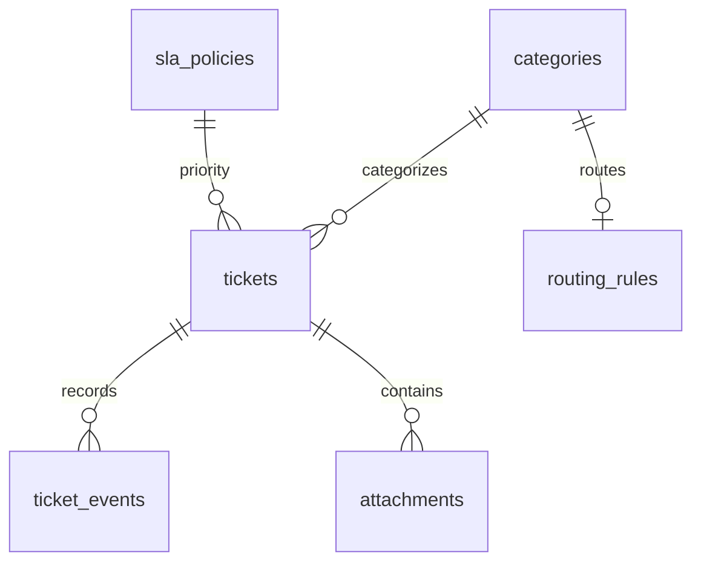

# Dữ liệu v1 — W2-06

Schema gồm bảy bảng nghiệp vụ. `categories`, `sla_policies`, `routing_rules` là
dữ liệu tham chiếu, được seed ngay khi bootstrap. Chưa có ticket giả lập của user thật.

- `tickets`: chủ sở hữu UUID Keycloak, danh mục, nội dung, ưu tiên và trạng thái.
- `ticket_events`: audit append-only do trigger sinh khi tạo ticket.
- `attachments`: metadata S3 và trạng thái quét; chưa có API upload tuần 2.
- `categories`: VPN, tài khoản, thiết bị, phần mềm.
- `sla_policies`: số phút phản hồi/xử lý theo mức ưu tiên; chưa có timer n8n.
- `routing_rules`: ánh xạ danh mục → team; tuần 2 chưa tự phân công.
- `device_requests`: nhu cầu thiết bị với số lượng, lý do, trạng thái pending.

Employee đọc dữ liệu của mình, staff (Agent/Manager) đọc tất cả ticket và yêu cầu
thiết bị. Chỉ Manager tạo Critical. Không nhận requester/status/assignee từ client.
Chưa cấp quyền cập nhật/xóa nghiệp vụ trong tuần 2.
`private.*` chứa helper claims và trigger, không expose qua PostgREST.
`migration_meta.applied` lưu checksum từng migration và thời điểm áp dụng.

Tài khoản `api_login` và `authenticator` chỉ chuyển sang role `authenticated`
trong transaction. Chủ sở hữu schema là tài khoản migration, không phải user API.
Mỗi lần mượn connection phải thiết lập claims mới và kết thúc bằng COMMIT/ROLLBACK.

Các trạng thái được dự trù trong schema, nhưng quy tắc chuyển trạng thái,
Poka-yoke theo loại yêu cầu, SLA, routing và upload thuộc tuần 3–4.
## Danh mục dữ liệu công khai (W5-07)

Trang `/du-lieu` đọc `/ld/catalog` và hiển thị ba bộ dữ liệu DCAT với giấy phép CC0 1.0,
ngày cập nhật và liên kết tải. Các tài nguyên sử dụng URI `/ld/services/{code}`,
`/ld/request-types/{code}` và `/ld/device-types/{code}`, có JSON-LD để kiểm tra trên Playground.
Khi W5-04 chưa cấu hình route API, web phục vụ JSON-LD mẫu cùng lược đồ URI và bản tải
có gắn nhãn giả lập. Các bản tải công khai nằm trong bundle web, tách khỏi DB nghiệp vụ.

Cảnh 3 demo có thể mở trực tiếp `/du-lieu` trong cửa sổ ẩn danh, tải một mẫu, rồi
chọn **Dịch vụ → Kết nối VPN** để xem JSON-LD, sao chép URI hoặc mở Playground.

## Tri thức và tự phục vụ (migration 012, W5-08)

- `knowledge_articles`: 6 bài Wiki.js (slug, tiêu đề, tóm tắt, `wiki_path`); nội dung bài ở `docs/wiki/`.
- `category_articles`: ánh xạ danh mục → bài kèm thứ tự; giao diện đọc bảng này qua API, không viết cứng.
- `self_service_resolutions`: một dòng mỗi lần người dùng bấm "Đã tự xử lý được" (người dùng từ JWT,
  danh mục, bài, thời điểm). RLS: mỗi người chỉ đọc dòng của mình; khóa ngoại kép bảo đảm bài thuộc
  gợi ý của danh mục.
- `reporting.self_service_weekly`: số lượt và số người theo tuần/danh mục/bài, không có định danh;
  chỉ cấp cho vai trò `reporting_reader` (Metabase, W5-06), không lộ qua PostgREST.

## Bộ sinh demo trong bối cảnh trường (W4-07)

`make seed` hoặc `node scripts/dxdesk.mjs seed` đọc team từ `/api/system/teams` và kiểm tra
các tài khoản mẫu trong Keycloak cục bộ. Hồ sơ giảng viên, sinh viên, cán bộ và đơn vị
là thuộc tính giả lập của phiếu. Các hồ sơ dùng chung những tài khoản demo có sẵn trong realm.
Các tham số `--weeks`, `--users`, `--weights=vpn:25,account:35` và `--scenario` điều chỉnh dữ liệu.
Phân bố mặc định theo [giả định của đội trong W4-10](khao-sat-trung-tam-cntt.md#tham-số-cho-bộ-sinh-dữ-liệu-giả-định-của-đội).
Dùng `--offline` để sinh thử khi stack chưa chạy. File xuất mặc định nằm trong `.local/reports`.
Xem [thẻ dữ liệu giả lập](data/README.md) cho kịch bản VPN, giấy phép và cách nạp DB demo.
