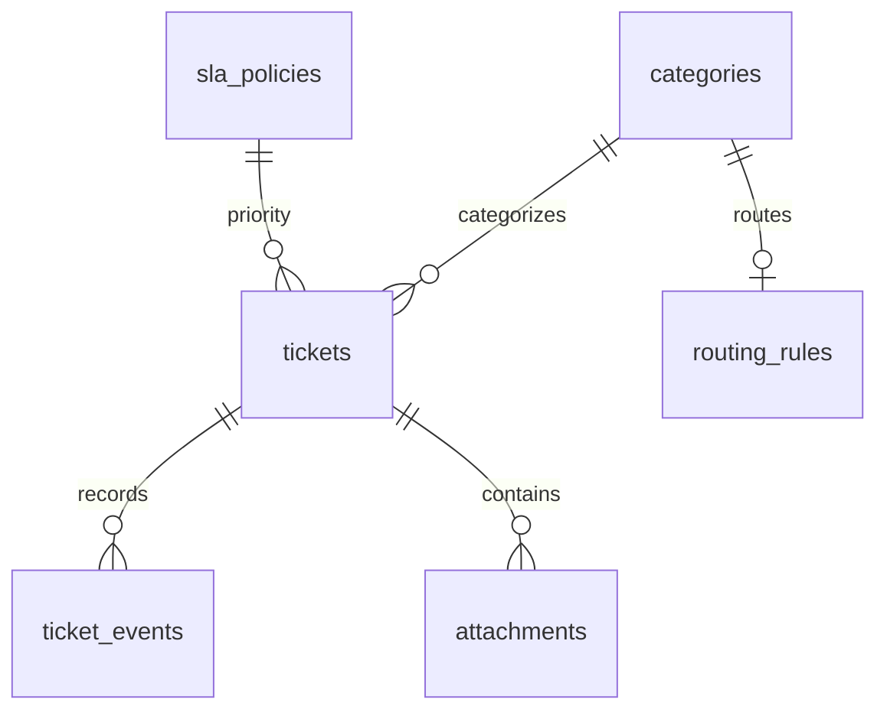

# Dữ liệu v1 — W2-06

Schema gồm bảy bảng nghiệp vụ. `categories`, `sla_policies`, `routing_rules` là
dữ liệu tham chiếu, được seed ngay khi bootstrap. Chưa có ticket giả lập của user thật.

- `tickets`: chủ sở hữu UUID Keycloak, danh mục, nội dung, ưu tiên và trạng thái.
- `ticket_events`: audit append-only do trigger sinh khi tạo ticket.
- `attachments`: metadata S3 và trạng thái quét; chưa có API upload tuần 2.
- `categories`: VPN, tài khoản, thiết bị, phần mềm.
- `sla_policies`: số phút phản hồi/xử lý theo mức ưu tiên; chưa có timer n8n.
- `routing_rules`: ánh xạ danh mục → team; tuần 2 chưa tự phân công.
- `device_requests`: nhu cầu thiết bị với số lượng, lý do, trạng thái pending.

Employee đọc dữ liệu của mình, staff (Agent/Manager) đọc tất cả ticket và yêu cầu
thiết bị. Chỉ Manager tạo Critical. Không nhận requester/status/assignee từ client.
Chưa cấp quyền cập nhật/xóa nghiệp vụ trong tuần 2.
`private.*` chứa helper claims và trigger, không expose qua PostgREST.
`migration_meta.applied` lưu checksum từng migration và thời điểm áp dụng.

Tài khoản `api_login` và `authenticator` chỉ chuyển sang role `authenticated`
trong transaction. Chủ sở hữu schema là tài khoản migration, không phải user API.
Mỗi lần mượn connection phải thiết lập claims mới và kết thúc bằng COMMIT/ROLLBACK.

Các trạng thái được dự trù trong schema, nhưng quy tắc chuyển trạng thái,
Poka-yoke theo loại yêu cầu, SLA, routing và upload thuộc tuần 3–4.
JSON-LD/DCAT thuộc tuần 5–7. Không đánh dấu những chức năng này hoàn thành chỉ vì
đã có cột hoặc bảng.
