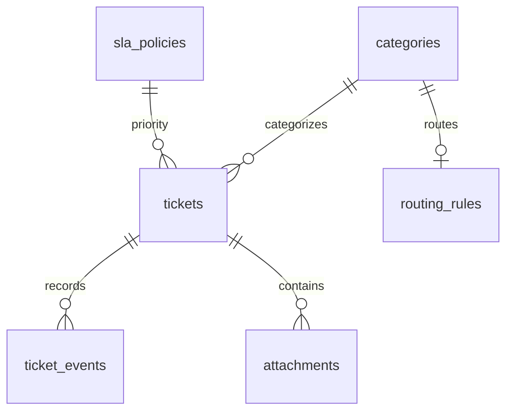

# Dữ liệu v1 — W2-06

Schema gồm bảy bảng nghiệp vụ. `categories`, `sla_policies`, `routing_rules` là
dữ liệu tham chiếu, được seed ngay khi bootstrap. Chưa có ticket giả lập của user thật.

- `tickets`: chủ sở hữu UUID Keycloak, danh mục, nội dung, ưu tiên và trạng thái.
- `ticket_events`: audit append-only do trigger sinh khi tạo ticket.
- `attachments`: metadata tệp (object nằm ở SeaweedFS, không phải S3 thẳng; đọc bằng
  URL do API ký HMAC theo ADR 0007/0009) và trạng thái quét.
- `categories`: VPN, tài khoản, thiết bị, phần mềm.
- `sla_policies`: số phút phản hồi/xử lý theo mức ưu tiên; chưa có timer n8n.
- `routing_rules`: ánh xạ danh mục → team; tuần 2 chưa tự phân công.
- `device_requests`: nhu cầu thiết bị với số lượng, lý do, trạng thái pending.

Employee đọc dữ liệu của mình, staff (Agent/Manager) đọc tất cả ticket và yêu cầu
thiết bị. Chỉ Manager tạo Critical. Không nhận requester/status/assignee từ client.
Chưa cấp quyền cập nhật/xóa nghiệp vụ trong tuần 2.
`private.*` chứa helper claims và trigger, không expose qua PostgREST.
`migration_meta.applied` lưu checksum từng migration và thời điểm áp dụng.

Tài khoản `api_login` và `authenticator` chỉ chuyển sang role `authenticated`
trong transaction. Chủ sở hữu schema là tài khoản migration, không phải user API.
Mỗi lần mượn connection phải thiết lập claims mới và kết thúc bằng COMMIT/ROLLBACK.

Các trạng thái được dự trù trong schema, nhưng quy tắc chuyển trạng thái,
Poka-yoke theo loại yêu cầu, SLA, routing và upload thuộc tuần 3–4.
JSON-LD/DCAT thuộc tuần 5–7. Không đánh dấu những chức năng này hoàn thành chỉ vì
đã có cột hoặc bảng.

---

## Cập nhật 02/11/2026 (đối chiếu code `72f72d7`)

Các dòng mô tả "tuần 2" ở trên giữ nguyên như nhật ký lịch sử W2-06; những nhận định
sau **không còn đúng** so với code hiện hành:

- **Bảy bảng vẫn đúng**, nhưng `categories` hiện có **6 danh mục active** chứ không chỉ
  bốn. Migration 003 thêm `access` ("Cấp quyền hệ thống") và `system-error`
  ("Lỗi hệ thống") — `db/migrations/003_ticket_workflow.sql:69-81`; bốn danh mục gốc ở
  `db/migrations/002_reference_data.sql:3-7`.
- **Không còn "chưa có API upload"**: luồng tải tệp đã có ở `POST /api/tickets/:id/attachments`
  và các endpoint đọc/tải (`apps/api/src/controllers.ts:211-305`, `apps/api/src/downloads.ts`).
- **"Quy tắc chuyển trạng thái, Poka-yoke theo loại, SLA, routing và upload thuộc tuần 3–4"
  (dòng trên) không còn đúng từ tuần 3**: đã hiện thực — máy trạng thái 9 giá trị/17 cạnh
  (`apps/api/src/state-machine.ts`, `db/migrations/003_ticket_workflow.sql`), Poka-yoke theo
  danh mục (`apps/api/src/rules.ts`, `005_ticket_integrity.sql`), SLA do trigger tính
  (`003_ticket_workflow.sql:193-208`). Routing mới có bảng + seed `team`, **chưa** tự phân công
  `assigned_to` (vẫn `null`). JSON-LD/DCAT vẫn là tuần 5–7.
- `attachments`: như đã sửa ở mục trên, object nằm ở **SeaweedFS** và đọc bằng **URL HMAC do
  API ký**, không phải "metadata S3".
