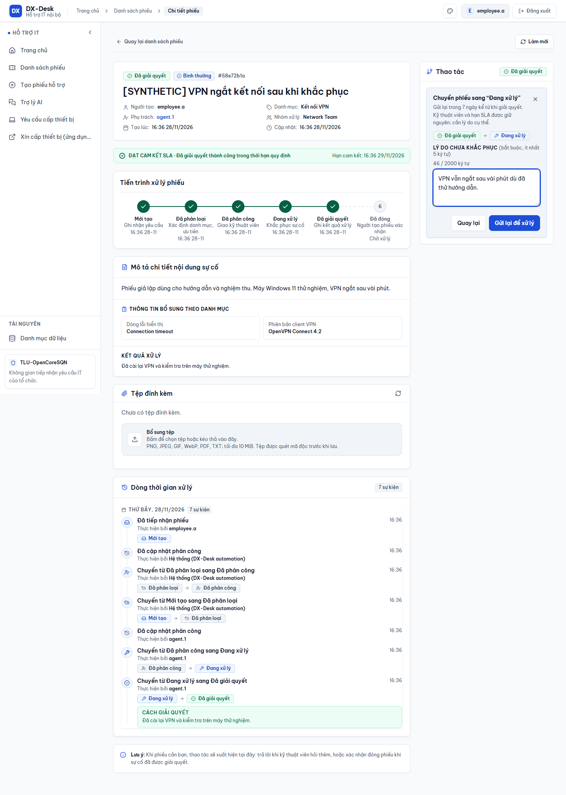
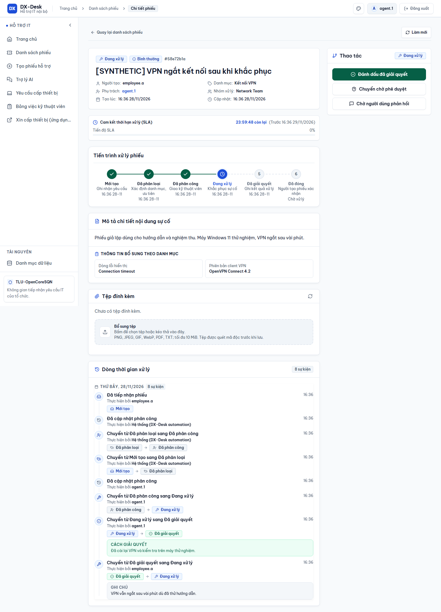
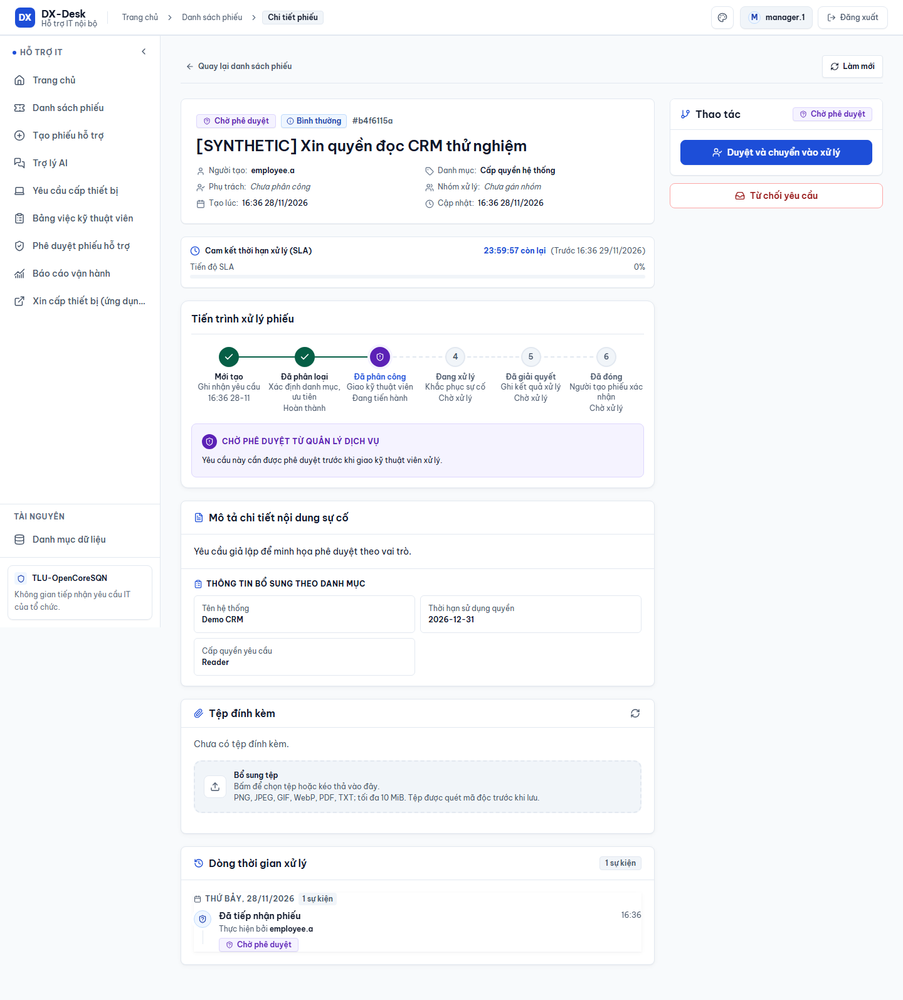
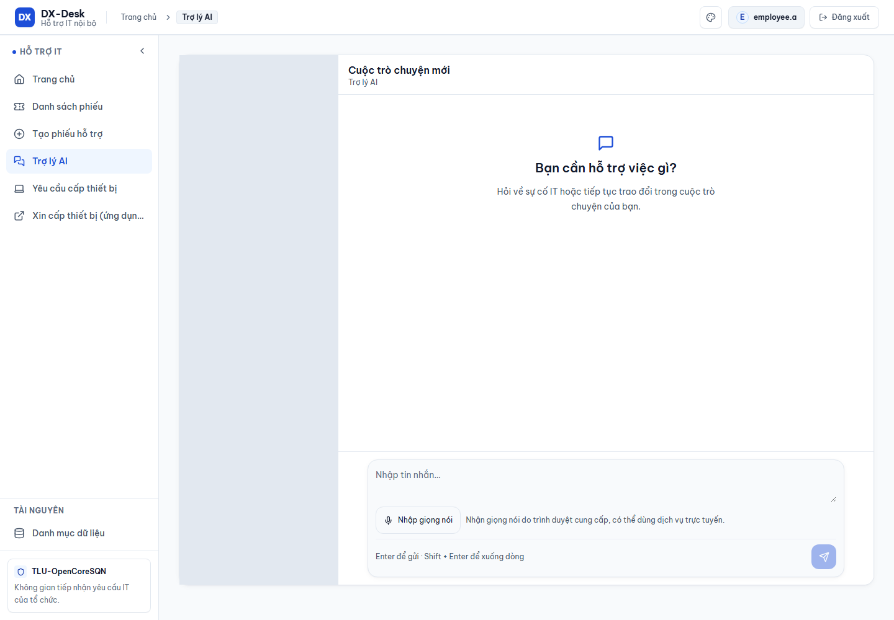

# Hướng dẫn sử dụng DX-Desk

Tài liệu cho giao diện sau PR #77, có hội thoại AI và mở lại phiếu trong 7 ngày.
Ảnh minh họa dùng tài khoản demo và phiếu có nhãn `[SYNTHETIC]`, không phải dữ liệu vận hành.
Địa chỉ mặc định là `http://localhost:9080`; quản trị viên cung cấp địa chỉ thật khi triển khai.
Mật khẩu nhận riêng từ quản trị viên, không gửi vào phiếu hoặc Trợ lý AI.

## Đăng nhập và chọn công việc

1. Mở DX-Desk, chọn **Đăng nhập hệ thống (SSO)**. Trang chuyển sang Keycloak.
2. Nhập tài khoản của bạn; nếu được yêu cầu, thiết lập/nhập mã OTP từ ứng dụng xác thực.
3. Sau khi quay lại, menu chỉ hiện chức năng được cấp. **Đăng xuất** khi dùng xong máy chung.

| Vai trò | Công việc chính | Nơi mở |
|---|---|---|
| Employee | Gửi và theo dõi phiếu của mình, yêu cầu thiết bị, hỏi trợ lý | Danh sách phiếu, Tạo phiếu hỗ trợ, Yêu cầu cấp thiết bị, Trợ lý AI |
| Agent | Nhận phiếu theo nhóm, yêu cầu bổ sung, xử lý và ghi kết quả | Bảng việc kỹ thuật viên |
| Manager | Duyệt yêu cầu, theo dõi thiết bị đúng đơn vị và báo cáo | Phê duyệt phiếu hỗ trợ, Yêu cầu cấp thiết bị, Báo cáo vận hành |

Một người có thể có nhiều vai trò. Vai trò không thay quyền sở hữu/đơn vị ở dữ liệu;
không thấy phiếu của người khác là hành vi dự kiến. Trang báo 404 cũng có thể vì không có quyền đọc.

## Employee: gửi phiếu và theo dõi đến khi xong

1. Chọn **Tạo phiếu hỗ trợ** (`/tickets/new`). Chọn đúng danh mục trước, vì mỗi danh mục có trường bắt buộc riêng.
   Ví dụ VPN cần phiên bản ứng dụng và thông báo lỗi. Mô tả điều đã thử, thời điểm lỗi và kết quả mong muốn.
2. Đọc bài tri thức được gợi ý. Nếu đã tự xử lý được, chọn hành động hoàn tất tự phục vụ;
   nếu chưa được, tiếp tục gửi phiếu. Bản nháp được giữ khi chọn giữ nháp, có thể xóa khi rời trang.
3. Chọn mức ưu tiên phù hợp; **Critical** cần quyền Manager. Thêm tệp nếu cần, tối đa 10 MiB/tệp;
   hệ thống chỉ nhận loại được phép và quét ClamAV. Tệp bị chặn/quét lỗi chưa được coi là đã gửi thành công.
4. Bấm **Gửi phiếu hỗ trợ**, chờ thông báo thành công, rồi **Xem chi tiết phiếu**.
   Tránh gửi lại chỉ vì hàng đợi chưa xử lý ngay. Phiếu VPN được n8n chuyển đến nhóm Network khi tự động hóa bật.
5. Theo dõi trạng thái, người phụ trách, hạn SLA và lịch sử tại `/tickets/<id>`.
   Tải tệp từ chính trang phiếu; liên kết tải có hạn, hết hạn thì bấm tải lại để lấy liên kết mới.

Khi phiếu **Chờ người dùng**, khung phản hồi trích câu hỏi của kỹ thuật viên.
Nhập câu trả lời rõ ràng (ít nhất 5 ký tự), chọn **Gửi phản hồi** để trả lại bước xử lý.
Khi **Đã giải quyết**, đọc kết quả, thử lại trên máy của bạn:

- Đã ổn: chọn **Xác nhận đã hài lòng, đóng phiếu** và xác nhận đóng.
- Chưa ổn: trong **7 ngày kể từ lần giải quyết gần nhất**, chọn **Chưa khắc phục được**,
  ghi lý do 5–2.000 ký tự rồi **Gửi lại để xử lý**. Phiếu trở lại **Đang xử lý**, giữ kỹ thuật viên,
  nhóm và hạn SLA cũ. Đây không phải một phiếu mới và không cấp lại thời gian SLA.
- Quá 7 ngày hoặc đã đóng: tạo phiếu mới và ghi mã phiếu cũ. Nếu không có thời điểm giải quyết
  hợp lệ trong lịch sử, nút mở lại không xuất hiện. Không sửa đồng hồ/trạng thái bằng cách khác.

Hủy phiếu chỉ khi giao diện còn cho phép và phải nêu lý do. Nếu báo phiếu đã thay đổi,
tải lại, đọc lịch sử rồi quyết định lại; không bấm lặp để ghi đè thao tác của người khác.

## Agent: nhận, xử lý và giải quyết

1. Mở **Bảng việc kỹ thuật viên** (`/work-queue`), chọn nhóm và hàng đợi **Nhóm của tôi · Chưa nhận**.
   Nhận phiếu bằng **Nhận**. Nếu người khác nhận trước, tải lại để xem người phụ trách thực tế.
   Manager không tự có quyền nhận phiếu chỉ vì là Manager.
2. Chọn **Đang phụ trách**, mở phiếu và **Mở chi tiết và lịch sử**.
   Đọc mô tả, trường danh mục, tệp đã quét, lịch sử và hạn SLA trước khi hành động.
   Bộ lọc nhanh trong trang chỉ lọc trang dữ liệu hiện tại; dùng hàng đợi, phân trang và bộ lọc máy chủ
   để tìm rộng hơn. SLA trên giao diện giúp ưu tiên; lịch sử là căn cứ thao tác.
3. Chọn **Bắt đầu xử lý**. Khi cần thêm dữ liệu, chọn **Chờ người dùng phản hồi**, ghi rõ cần gì
   rồi **Gửi yêu cầu bổ sung**. Người dùng trả lời ngay trên phiếu; mở lại chi tiết để đọc.
4. Khi đã xử lý, chọn **Đánh dấu đã giải quyết**, nhập kết quả thực tế 5–2.000 ký tự và xác nhận.
   Nêu cách khắc phục và cách người dùng kiểm tra lại. Người tạo xác nhận đóng sau đó.

Đề xuất phân loại của AI chỉ là gợi ý: kiểm tra danh mục, ưu tiên, nhóm và nội dung;
chỉnh lại nếu cần rồi chủ động áp dụng. Không tự xem gợi ý là thao tác đã thành công.
Phiếu mở lại bởi người tạo giữ nguyên phụ trách/SLA, vì vậy kiểm tra lại trong hàng việc của mình.

## Manager: duyệt và theo dõi

Mở **Phê duyệt phiếu hỗ trợ** (`/approvals`) và xem từng yêu cầu đang chờ.
Đối chiếu hệ thống, mức quyền, hạn dùng và lý do trước khi đồng ý. Từ chối phải ghi lý do
để người tạo biết cần bổ sung gì. Hai người quyết định cùng lúc có thể báo xung đột:
tải lại để đọc quyết định đã ghi, không gửi lại một quyết định cũ.

**Báo cáo vận hành** (`/bao-cao`) chỉ cho Manager. Chọn khoảng thời gian đúng trước khi so sánh;
phân biệt số phiếu, tỷ lệ SLA và số bước xử lý H-P-D-I. Dữ liệu seed/demo chỉ để minh họa,
không dùng làm chỉ số doanh nghiệp thật. Liên kết Metabase có thể cần tài khoản Metabase riêng;
phiên bản đang dùng không mặc định có SSO OIDC miễn phí.

## Xin cấp thiết bị và nhận biên bản

1. Từ **Yêu cầu cấp thiết bị** hoặc **Xin cấp thiết bị (ứng dụng 2)** (`/thiet-bi/`),
   chọn loại, số lượng và ghi lý do. Ứng dụng 2 dùng cùng Keycloak, có thể chuyển qua trang đăng nhập.
2. Gửi một lần, theo dõi mã yêu cầu và trạng thái. Yêu cầu gắn với đơn vị đã cấu hình trong tài khoản.
3. Manager đúng đơn vị duyệt hoặc từ chối có lý do. Bộ phận IT chuẩn bị và xác nhận bàn giao
   theo các nút hiện ở trạng thái hiện hành. Không đánh dấu bàn giao khi chưa bàn giao thực tế.
4. Sau bàn giao, người có quyền tải **biên bản PDF**. Chỉ các bên được phân quyền đọc được;
   nếu URL hết hạn, mở lại yêu cầu để xin URL mới. Biên bản được lưu trong SeaweedFS.

## Trợ lý AI: hội thoại và giọng nói

Menu **Trợ lý AI** (`/tro-ly`) chỉ hiện khi tính năng được bật cho tài khoản/hồ sơ triển khai.
Nếu chưa cấu hình AI hoặc dịch vụ chưa sẵn sàng, báo quản trị viên; không gửi khóa API vào ô chat.

- **Cuộc trò chuyện mới** tạo ngữ cảnh riêng. Chọn cuộc cũ để hỏi tiếp, đổi tên để dễ tìm.
  Tải lại trang vẫn giữ tin nhắn; **Tải tin nhắn cũ** xem phần lịch sử trước đó.
  Xóa hội thoại cần xác nhận và xóa cả tin nhắn/bộ nhớ. Trên điện thoại mở danh sách bằng **Mở lịch sử hội thoại**.
- Hỏi về mạng/VPN, tài khoản/quyền, phần mềm, thiết bị, phiếu hoặc báo cáo IT. Nêu lỗi và điều đã thử.
  Câu ngoài phạm vi sẽ được hướng về hỗ trợ IT. Trợ lý dùng ngữ cảnh hội thoại và tri thức Wiki;
  kiểm tra nguồn/kết quả trước khi làm theo, không đưa mật khẩu/OTP/dữ liệu nhạy cảm vào chat.
- Bấm **Nhập giọng nói**, cấp quyền micro và nói tiếng Việt. Nội dung vào ô nhập,
  **chưa tự gửi**. **Tạm dừng micro** để sửa chữ, **Tiếp tục nói** nối thêm, **Kết thúc** đóng micro.
  Nhận giọng nói phụ thuộc trình duyệt, HTTPS/localhost và dịch vụ của trình duyệt;
  âm thanh có thể được gửi tới dịch vụ đó. DX-Desk không lưu audio. Nhập chữ vẫn dùng được khi micro không hoạt động.
- Bấm gửi/Enter; Shift+Enter xuống dòng. Trong lúc chờ hiển thị **Thinking**,
  có thể **Dừng trả lời** cả lúc chuẩn bị gửi hoặc đang nhận. Phần đã nhận được giữ;
  không mặc định xem phần bị dừng là kết quả hoàn chỉnh. Khi xong có thể mở chi tiết và nguồn Wiki.
- **Nghe câu trả lời** dùng giọng trên thiết bị, có tạm dừng/tiếp tục/dừng.
  Trình duyệt thiếu giọng tiếng Việt có thể đọc bằng giọng mặc định. Đổi hội thoại, gửi câu hỏi
  hoặc rời trang sẽ dừng micro/đọc để tránh thu lại tiếng đọc.
- Nếu AI đề xuất tạo phiếu/task, đọc bản xem trước rồi **xác nhận** hoặc hủy.
  Chỉ báo đã tạo khi có mã/kết quả từ hệ thống. AI không tự phê duyệt hoặc vượt quyền người đăng nhập.

Mỗi hội thoại chỉ sinh một câu trả lời tại một thời điểm. Khi mất mạng, đợi đồng bộ lại
hoặc tải lại trang trước khi gửi tiếp. Nếu tiến trình chết giữa chừng, lease lượt đang dở
hết sau khoảng 5 phút. Token hết hạn lúc hoàn tất không làm mất kết quả đã được dịch vụ ký và lưu.

## Khi cần hỗ trợ

Ghi thời điểm, mã phiếu/yêu cầu, vai trò và thông báo lỗi; gửi ảnh đã che thông tin nhạy cảm.
401: thử đăng nhập lại. 403: kiểm tra quyền với quản trị viên. 404: kiểm tra mã và quyền sở hữu.
Không gửi cookie, token, mật khẩu hoặc khóa AI. Vận hành xem [van-hanh.md](van-hanh.md).

Người nghiệm thu khác tác giả thực hiện lần lượt: tạo VPN → nhận/xử lý → hỏi bổ sung/trả lời →
giải quyết → mở lại có lý do → giải quyết/đóng; duyệt cấp quyền; xin/duyệt/bàn giao thiết bị/PDF;
chat mới/hỏi tiếp/đổi tên/xóa, nhập giọng nói và đọc/tạm dừng. Ghi SHA và kết quả vào PR/issue #91.
