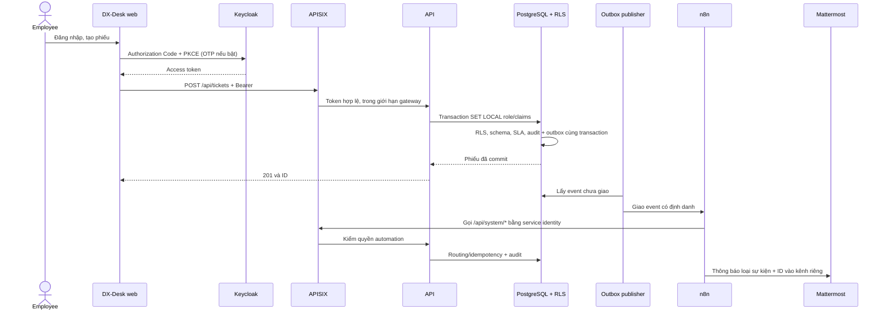

# Kiến trúc DX-Desk

Tài liệu mô tả source hiện hành; các lựa chọn và giới hạn giấy phép ở [ADR](adr/README.md)
và [THIRD-PARTY-NOTICES](../THIRD-PARTY-NOTICES.md). Hồ sơ `full` có AI/Wiki/báo cáo;
`demo-light` chỉ bật tập dịch vụ nhẹ hơn. Cấu hình dev bind localhost, không phải cấu hình Internet đã harden.

## Ba tầng DX-OS và H-P-D-I

| Tầng | Trách nhiệm | Thành phần trong kho |
|---|---|---|
| 1 — nền tảng dùng chung | Định danh, gateway, dữ liệu, kho tệp, quét tệp và hạ tầng quy trình | Keycloak, APISIX, PostgreSQL/PostgREST, SeaweedFS, ClamAV, n8n; Compose và cấu hình versioned |
| 2 — năng lực nghiệp vụ/cấu hình | Máy trạng thái, SLA, phân quyền dữ liệu, routing, workflow, topic và công cụ AI dùng chung | API NestJS, RLS/trigger/RPC, outbox, `config/doanh-nghiep`, assistant/wiki-index |
| 3 — ứng dụng và trải nghiệm | Thao tác của người dùng, tri thức, thông báo, phân tích | DX-Desk web, ứng dụng xin thiết bị, Wiki.js, Mattermost, Metabase |

Các tầng mô tả trách nhiệm, không nhất thiết là ba máy chủ. n8n là nền tảng thực thi;
workflow nghiệp vụ của nó thuộc tầng năng lực. Thay doanh nghiệp ưu tiên sửa cấu hình đã review,
không nhân bản ứng dụng rồi sửa tên cứng trong source.

| Trục | Cách hiện thực | Điểm kiểm soát |
|---|---|---|
| H — con người | Employee, Agent, Manager, xác nhận đề xuất AI | Quyền, chủ sở hữu/đơn vị và audit người thực hiện |
| P — quy trình | Máy trạng thái, phê duyệt, SLA, outbox/n8n | API và DB cùng quy tắc, idempotency và retry |
| D — dữ liệu | PostgreSQL/RLS, tệp SeaweedFS, JSON-LD/DCAT, báo cáo | Giới hạn hàng/cột, URL tải có hạn, tách dữ liệu công khai và riêng |
| I — trí tuệ | Gemini qua API tương thích OpenAI, tri thức Wiki/Qdrant, triage | Topic/few-shot, nguồn tri thức, quyền công cụ và xác nhận thao tác ghi |

`reporting.automation_weekly` đếm **bước xử lý theo actor**, không phải số phiếu hoàn tất hay
thước đo chính xác thời gian tiết kiệm. Seed synthetic không đại diện vận hành doanh nghiệp.

## Luồng một phiếu

Publisher/retry không bảo đảm mạng chỉ giao một lần. Quy tắc nghiệp vụ ghi nhận định danh để
thử lại không nhân đôi hiệu ứng. n8n dừng thì event còn trong DB; phục hồi cần kiểm cả hiệu ứng
và thông báo, không chỉ xem container chạy. Ticket/event/outbox commit cùng transaction;
audit lỗi thì thao tác trạng thái rollback. Claim đồng thời chỉ một Agent thắng.

Tệp đi qua API để kiểm quyền, giới hạn và quét ClamAV trước khi lưu SeaweedFS.
Không công khai bucket/Filer. Tải tệp qua API kiểm lại quyền và cấp URL ký ngắn hạn,
chỉ tệp sạch; URL hết hạn cần xin lại. Biên bản thiết bị PDF cũng đi theo quyền các bên liên quan.

## Zero-Trust và ranh giới quyền

Keycloak quản lý định danh, role, thuộc tính đơn vị và MFA. Web dùng PKCE;
gateway kiểm chữ ký/issuer/audience/hạn token và giới hạn tần suất/kích thước request.
API vẫn xác minh token, DTO và quy tắc nghiệp vụ; không tin dữ liệu role/owner trong body.
API và PostgREST truy cập qua role hạn chế, **NOBYPASSRLS**, với claims cục bộ transaction.
PostgreSQL RLS/trigger/RPC là ranh giới cuối nên gọi REST trực tiếp không bỏ qua quyền.
Không dùng tài khoản owner/superuser làm kết nối API phục vụ người dùng.

Employee đọc phiếu của mình; Agent/Manager có phạm vi theo nghiệp vụ; thiết bị còn giới hạn
đơn vị/quan hệ các bên. Role trong UI chỉ điều khiển menu và nút. Endpoint automation cần
service identity, không nhận token Employee thay thế. Thông báo Mattermost chỉ có loại sự kiện
và ID, không có tiêu đề/mô tả/người yêu cầu/link chứa dữ liệu riêng.

Chuyển `resolved → in_progress` của người tạo cần lý do 5–2.000 ký tự và trong 7 ngày từ
audit giải quyết gần nhất. Trigger DB chặn quá hạn và thay assignee/nhóm/SLA;
`updated_at` không thể dùng để kéo dài cửa sổ. Staff giữ quy trình xử lý riêng đã có.
Chi tiết SQLSTATE, vai trò và các cạnh máy trạng thái: [API contract](api/contract.md).

`/ld/*` chỉ công bố danh mục/reference data được thiết kế để công khai, không xuất bản phiếu
hoặc danh tính. Metabase dùng lớp reporting và kết nối đọc hạn chế; không dùng DB owner.
Wiki.js có SSO Keycloak. Mattermost/Metabase bản đang dùng có giới hạn SSO theo
[ADR 0008](adr/0008-sso-keycloak-cho-ung-dung-co-san.md), không quảng bá mặc định SSO toàn bộ.

## AI, ngữ cảnh và giọng nói

Assistant gọi mô hình bên ngoài; chỉ khóa server trong `.env`, không đưa khóa vào bundle web.
Wiki-index đọc các bài được phép, tạo embedding và cập nhật Qdrant nội bộ. Assistant phân loại
chủ đề từ cấu hình/few-shot và ngữ cảnh gần nhất, tìm tri thức phù hợp rồi trả lời có nguồn.
Cấu hình inference này không huấn luyện lại trọng số. Bộ 24 câu đánh giá độc lập nằm cạnh cấu hình;
không coi câu trả lời đúng một lần là bảo đảm không sai trong tương lai.

Session/turn/memory lưu PostgreSQL, tách theo chủ sở hữu bằng RLS. Lịch sử dài được tóm tắt,
giữ cửa sổ gần nhất. Tóm tắt lỗi/rỗng thì dùng phần gần nhất và giữ checkpoint cũ để thử lại,
không xóa lịch sử gốc. Một session có một lượt pending với lease 5 phút. Xóa session xóa cả
turn/memory; không dùng ngữ cảnh của session khác làm prompt.

Khởi tạo/đọc/công cụ cần JWT người dùng. Hoàn tất lượt qua endpoint **nội bộ không mở qua gateway**,
HMAC ràng buộc owner + session + turn + kết quả; chỉ cập nhật lượt đã tồn tại qua RLS.
Nhờ vậy token hết hạn giữa lúc sinh không làm mất kết quả, không cấp thêm quyền đọc/ghi mới.
Đề xuất tạo phiếu/task vẫn cần người dùng xác nhận và quyền hợp lệ khi thực thi.
Tri thức/lịch sử là dữ liệu, không được tin như chỉ thị hệ thống để vượt ranh giới công cụ.

Web nhận stream, hiển thị Thinking khi chưa có câu trả lời, ẩn chi tiết Wiki trong lúc chờ.
Dừng sinh dùng AbortController; vòng đồng bộ hội thoại retry có backoff và dừng khi rời trang.
Nhận/đọc giọng nói dùng Web Speech API phía trình duyệt, người dùng chủ động bật.
DX-Desk không lưu audio; dịch vụ nhận giọng nói của trình duyệt có thể xử lý từ xa.
Micro/TTS dừng khi đổi hội thoại hoặc gửi, tránh tiếng đọc quay vào prompt.

## Dữ liệu bền vững và giới hạn triển khai

PostgreSQL chính, các DB Keycloak/n8n/Wiki/Mattermost/Metabase và SeaweedFS cần backup nhất quán.
Backup tạm dừng writers, giữ manifest/hash và roles; `.env`/khóa mã hóa lưu riêng.
Restore kiểm archive trước khi thay DB nhưng không là giao dịch nguyên tử cho toàn stack.
Qdrant dựng lại từ nguồn Wiki. Hướng dẫn thao tác ở [vận hành](van-hanh.md).

Compose một máy hiện chưa phải HA/DR nhiều vùng. Bản Internet cần URL/TLS, cấu hình client,
quản lý bí mật và kiểm tra SSO thực tế riêng. Release v1.0.0, máy sạch và người nghiệm thu độc lập
chỉ được đánh dấu khi có bằng chứng đúng SHA; source/PR hiện tại chưa đồng nghĩa đã phát hành.
